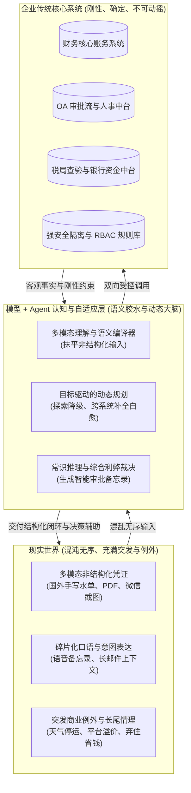
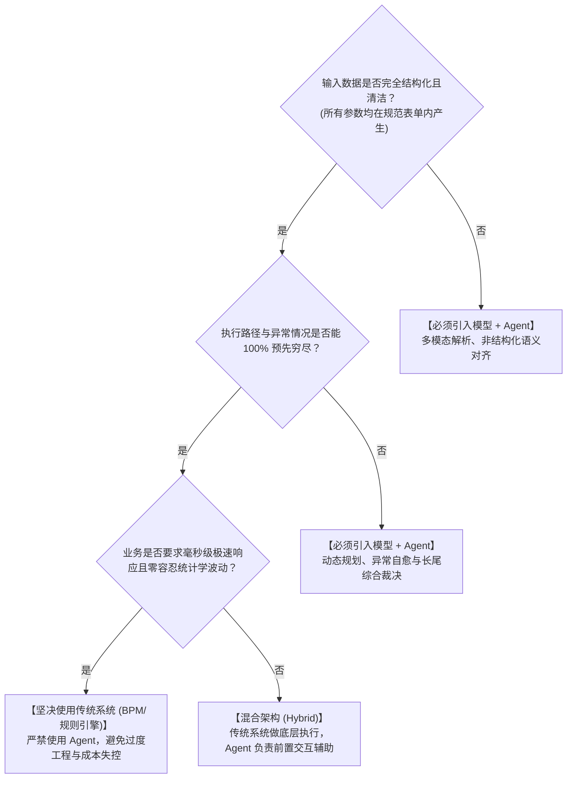

# 大模型与 Agent 的真实价值：与传统企业系统对比与工程选型指南

## 1. 核心问题背景：为什么常感觉“没看出 Agent 和传统系统的区别”？

在许多企业智能化尝试中，开发者容易产生一个强烈的困惑：
> *“发票查验、行程匹配、额度测算、权限控制、审批流转……这些逻辑在传统的 OA、ERP 或规则引擎（如 Camunda/Drools/泛微/飞书审批）里早已非常成熟。如果只是用大模型从一句话里提取城市和金额，然后再走一遍写死的业务规则，大模型和 Agent 的不可替代性究竟在哪里？”*

这种质疑是完全成立的，甚至切中了业界大量“伪 Agent”项目的要害：
如果一个业务场景满足：
1. **流程高度固定**（静态有向无环图 DAG，分支完全预先穷尽）；
2. **输入高度结构化**（员工严格在下拉菜单和格式化输入框中点选，发票扫码直接获得结构化字段）；
3. **规则完全封闭**（如 `金额 > 300` 找总监，`金额 <= 300` 自动放行）。

**在上述场景下，传统系统（前端表单 + 规则引擎 + 数据库事务）在稳定性（100% 确定）、成本（0 Token 消耗）、响应时延（<10ms）和审计合规上，全方位碾压 Agent。** 把原本 5 秒钟点选的表单改成聊天对话框，反而引入了模型延迟、Token 成本以及概率性解析失败的风险，是典型的**负价值过度工程**。

---

## 2. 传统系统无法逾越的三大现实断崖

传统系统的自动化是以**“外部世界必须遵守刚性规范”**为前提假设的。然而，企业真实经营活动充满混乱、碎片与突发例外，传统系统在此暴露出三个根本性断崖：

### 断崖一：非结构化现实与刚性表单之间的“人工搬运代价”
* **传统系统的困境**：传统系统无法理解非结构化材料。面对 5 张不同格式的供货凭证、微信群里领导的口头承诺截图、打车行程单 PDF，必须依赖人工坐席逐字肉眼阅读、对账、核算，再手动输入到表单的 20 个字段中。**传统系统的自动化，是以沉重的人工预处理为代价的。**
* **模型 + Agent 的质变**：大模型本质上是一个通用语义与多模态编译器。无论是随意口述、扫描件、长邮件还是跨国票据，它能直接理解混乱现实，并精确编译为企业系统需要的标准参数，抹平现实到系统的摩擦成本。

### 断崖二：静态硬编码流水线 vs 目标驱动的自适应规划
* **传统系统的困境**：传统工作流是静态绑定的。如果报销时发现“缺少 OA 出差申请单”，传统系统只能机械抛错阻断并打回；如果第三方发票核验接口超时，流程直接崩溃。
* **模型 + Agent 的质变**：Agent 是**目标驱动（Goal-oriented）的自治执行体**。
  - **环境感知与降级自愈**：当主核验接口超时，Agent 自主降级调用本地 OCR 进行离线二维码查验；
  - **跨系统主动闭环**：发现缺少出差申请时，Agent 不是简单打回，而是检索员工日程表，发现当天有与客户签约的既定行程，主动向员工提议：*“检测到您 9月20日有签约日程，是否需要我联动 OA 系统为您自动补提一张差旅申请单并关联此报销？”*
  - **传统系统是被动校验器，Agent 是主动替你把事情办成的代理人。**

### 断崖三：冰冷数值判断 vs 复杂商业语境的情理权衡
* **传统系统的困境**：规则引擎只能做死板的布尔比较（如 `金额 > 200` 即超标违规打回）。
  - 现实情况往往复杂：“当晚暴雨红色预警平台动态加价 2.5 倍，打车花费 350 元（超标 150 元）；但员工连夜赶回，**免除了当晚 600 元的酒店住宿费**，实际为公司节约了总支出”。
  - 传统系统对此一无所知，只会机械地拦截违规，迫使员工和财务在线下反复发邮件撕扯扯皮。
* **模型 + Agent 的质变**：大模型具备**常识推理与综合上下文权衡**能力。它在推送审批时，不是只发一个冰冷的“超标”，而是自动生成一份高质量的《智能审批备忘录》：
  > *“系统综合研判：该笔交通费超标 150 元，但经核验当晚暴雨预警与平台溢价系数属实，且由于连夜返程直接免除了原定的 600 元酒店支出，实际使公司该次出差综合差旅成本降低约 450 元。建议予以合规特批。”*
  - **它把人类从繁重的“信息搜集与调查员”角色，解放为纯粹的“最终决策裁决者”。**

---

## 3. 传统系统 vs 大模型+Agent 深度对比矩阵

| 评估维度 | 传统工作流系统 (BPM / 规则引擎) | 大模型 + 智能体架构 (LLM + Agent) | 核心技术分水岭 |
| :--- | :--- | :--- | :--- |
| **输入适应性** | 仅接受规范、干净的表单字段；脏数据或非结构化数据直接报错 | 容纳自然语言、多模态扫描件、语音口述与长尾异构数据 | **非结构化语义与多模态解析** |
| **系统间协同** | 强契约硬编码集成，新增系统或接口改动需研发重构发布 | 接口封装为工具元数据（Tools/MCP），模型按目标自适应组装调度 | **异构系统解耦弹性** |
| **执行路径** | 静态死板，必须在设计期穷尽所有 `if-else` 分支 | 动态规划，根据工具调用反馈与环境状态自主决策下一步 | **目标驱动与探索容错** |
| **异常自愈** | 条件不满足则抛异常打回，需人工介入重新流转 | 主动探查原因、反问澄清、寻找降级替代方案或自主前置补单 | **主动性 (Proactivity)** |
| **规则复杂度** | 随着业务例外增加，代码里的条件分支呈指数级膨胀，系统脆化 | 底层守牢安全红线，长尾的语境理解交由大模型，规则库保持极简 | **应对长尾复杂度的抗衰能力** |
| **交互心智成本**| 用户必须学习并适应系统的 50 个表单字段和流转逻辑 | 系统来适应用户的表达习惯和现实行为习惯 | **心智成本向系统侧转移** |

---

## 4. 架构定位：Agent 在企业 IT 架构中的真实生态位

必须明确：**Agent 绝不是为了替代传统数据库、ERP 或规则引擎，而是在底层刚性系统与外部混乱现实之间，充当一层高认知、高弹性的“智能胶水与自治调度器”**：

1. **下层（确定性底座）**：保留传统数据库、核心账务、RBAC 鉴权与硬编码风控。这一层必须冷酷、死板、100% 确定，守住企业资金安全与法务红线；
2. **中间层（Agent 智能层）**：负责多模态意图编译、跨系统工具组装、异常降级调度与上下文利弊分析；
3. **上层（用户感知层）**：极大降低用户的交互摩擦，把繁重的表单录入转化为极简的目标交付。

---

## 5. 工程选型决策树：何时用传统系统？何时用 Agent？

### 坚决使用传统系统（千万别用 Agent）：
* **流程高度固定且封闭**：如银行流水自动对账、员工标准打卡考勤、固定费率发票验真；
* **不允许任何统计学波动**：必须 100.00% 幂等与确定，无法容忍 0.1% 的意图漂移；
* **高并发低延迟**：QPS 在万级以上，响应时延要求在 10ms 以内。

### 必须引入模型 + Agent（传统系统无法胜任）：
* **非结构化与多模态壁垒**：涉及合同审核、多国单据混合报销、长邮件解析、多格式票据核验；
* **跨多异构系统长链路**：需要跨越 4~5 个没有互通标准的系统，频繁遇到数据不全或接口报错，需要根据上下文寻找替代路径；
* **规则库膨胀陷入泥潭**：例外情况多如牛毛，开发人员不敢动旧代码，需要大模型基于制度原则进行情理分析并生成决策摘要。

---

## 延伸阅读（企业级 Agent 架构思考三部曲）
- [第一篇：大模型与 Agent 的真实价值：与传统企业系统对比与工程选型指南](./agent_vs_traditional_systems.md)
- [第二篇：大模型能力边界与 Agent 架构研发第一性原则（防衰变指南）](./agent_design_principles.md)
- [第三篇：业务系统底座与 Agent 能力的辩证关系：巧妇能为无米之炊吗？](./business_systems_vs_agent_capabilities.md)
