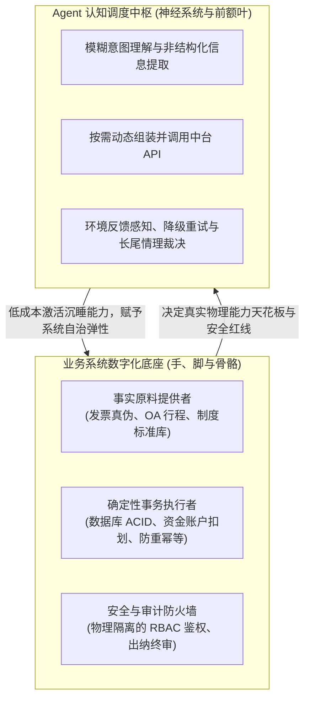

# 业务系统底座与 Agent 能力的辩证关系：巧妇能为无米之炊吗？

## 1. 核心问题引入：“最终还是看业务系统是真的支持的能力吗？”

在企业推进智能化落地时，技术团队经常会直面一个极具穿透力的问题：
> *“查发票需要发票中台的验真接口，查行程需要 OA 系统的出差单接口，报销需要财务系统的建单接口……如果底层业务系统本身能力缺失、接口残缺不全、数据没有沉淀，或者根本不支持自动化，那所谓的 Agent 是不是巧妇难为无米之炊？最终到底是不是完全看业务系统是真的支持的能力？”*

这个问题的答案是：**是，但又不全是。**

更精确的工程定调是：
> **业务系统的数字化底座，决定了 Agent 的“物理天花板与安全下限”；但 Agent 的认知与编排调度，决定了这些底层能力能否“以极低成本被串联激活，并真正转化为面向用户的端到端业务价值”。**

---

## 2. 承认残酷现实：业务系统决定了 Agent 的物理天花板

大模型不是可以无中生有的“魔法”，它本质上是一个高级的逻辑与语义推理单元。在严肃的企业生产环境中，脱离了业务系统的 Agent 必定寸步难行：



### 1. 没有事实原料，大模型必然滑向“幻觉深渊”
* 如果企业内部**压根没有对接税局的发票验真接口**，Agent 无论换用多先进的旗舰大模型，也无法百分之百辨别发票真假；
* 强行要求大模型仅凭发票图片去判断真伪，大模型必然会通过概率关联去“脑补”一个看似合理的税号，导致伪造假票畅通无阻，造成严重的合规事故。
* **工程铁律：数据资产是事实的唯一锚点。业务系统没有沉淀的数据，严禁逼迫大模型去凭空回答。**

### 2. 确定性系统守住资金安全与事务一致性的底座
* 资金会不会重复划扣、单据会不会并发重复创建，完全取决于底层业务系统的**事务隔离级别（ACID）**和**接口幂等控制机制（Idempotency）**；
* 权限能不能守住，完全取决于底层系统是否实现了严谨的 **RBAC 鉴权机制**。如果底层接口本身存在未授权直接转账的后门，Agent 再怎么通过 Prompt 做自我防护也是纸上谈兵。

> **软件工程定律：Garbage In, Garbage Out; No Infrastructure, No Automation（没有基础设施，就没有真正的自动化）。业务系统是一切企业智能化的前置必要条件。**

---

## 3. 为什么说“又不全是”？传统系统长期“有能力却瘫痪”的三大鸿沟

如果仅仅依靠业务系统，很多拥有数百套先进系统的传统大型企业，为什么数字化体验依然极差？
因为传统业务系统虽然具备大量“原子能力”，但在面对真实人类业务时，存在三个跨不过去的鸿沟：

### 鸿沟一：“抽屉式 API”到端到端目标的断裂
* **传统系统的痛点**：发票系统能查验真伪，OA 系统能查出差单，HR 系统能查部门归属，财务系统能生成草单。
  - 这些能力虽然都存在，但它们散落在不同部门的“抽屉”里，接口规范各异、认证机制不通；
  - 传统开发为了完成一次差旅报销自动化，必须做为期 3~6 个月的系统集成专项，编写数千行僵死生硬的胶水代码与报文转换；只要任何一方接口改了一个字段，整条链路直接报废。
* **Agent 的破局**：把这些接口作为工具元数据（Tools / MCP）暴露给 Agent。Agent 能根据当前目标，**在运行时自适应决定调用顺序、自动对齐跨系统的异构参数**，将原本耗时数月的集成开发压缩为几小时的工具注册。

### 鸿沟二：“人形数据路由器”的沉重摩擦
* **传统系统的痛点**：业务系统支持按发票号查真伪，也支持按工号查出差。但以前是怎么跑通闭环的？**完全依赖员工的人脑充当“数据路由器”**：
  - 员工登录发票系统核验，导出结果；
  - 登录 OA 系统找审批单号，截图对账；
  - 确认合规后，再逐字敲进财务报销系统的 20 个格子表单里。
* **Agent 的破局**：业务系统有操作能力，但缺乏认知与多模态搬运能力。大模型充当了**“通用认知搬运工”**，把人类肉身从枯燥的数据搬运中解脱出来。

---

## 4. 当业务系统“不完善”时，Agent 具备降级自愈的弹性

在现实企业中，业务系统“不支持”往往不是“绝对没有”，而是处于不同程度的半成熟状态。Agent 架构在不同阶段展现出独特的降级应对弹性：

| 业务系统成熟度状态 | 传统系统的应对结果 | Agent 架构的弹性应对策略 |
| :--- | :--- | :--- |
| **状态 A：无标准化 API，但有 Web/客户端 UI 界面** | 完全卡死，系统集成项目宣告失败 | 调度 Headless Browser（Playwright）或 RPA，Agent 像人一样看屏幕、点界面、填表单完成操作 |
| **状态 B：无硬编码规则，只有静态制度文档 (PDF/Word)** | 必须等业务专家把规则翻译成千行代码配置进规则引擎 | 挂载企业制度知识库（RAG），大模型通过常识推演与原则理解，将静态文本直接转为动态合规判定 |
| **状态 C：底层能力完全缺失 (如真无验真接口)** | 流程直接中断报错 | 显式触发**人在回路（HITL）**，向用户与财务明示能力边界，将原件派发人工复核，绝不假装支持 |

---

## 5. 架构终局隐喻：手脚骨骼与神经前额叶的共生关系

在现代化智能架构中，二者构成了不可分割的有机生命体：

```
+-------------------------------------------------------+
|              Agent 认知层（前额叶大脑与神经系统）        |
|  - 意图理解、环境感知、策略规划、多模态搬运、长尾情理裁决  |
+-------------------------------------------------------+
                           │ (自适应组装与受控调用)
                           ▼
+-------------------------------------------------------+
|              业务系统层（手、脚、肌肉与骨骼）           |
|  - 发票查验、OA行程、记账核算、资金支付、RBAC硬隔离      |
+-------------------------------------------------------+
```

* **手脚残疾，大脑再聪明也寸步难行**：如果业务底座没有 API、没有数据资产沉淀、没有事务隔离，Agent 就是悬在空中的楼阁；
* **手脚健全但缺乏神经大脑，就只是一堆冰冷的机械零件**：如果业务系统只有死板的 API，而没有 Agent 去做多源数据清洗、自适应规划和例外吸收，企业就永远需要雇佣庞大的人工坐席充当系统间的“润滑油”。

---

## 6. 企业落地评估决策阶梯

在决定是否上马 Agent 项目前，建议按以下阶梯自检：

1. **第一步（先修路）：评估业务系统的原子能力是否就绪**
   - 核心系统是否已具备标准的 API 接口或可操作界面？
   - 核心数据是否存在确定性数据库中，而不是只散落在员工的个人电脑里？
   - *（若未就绪，优先做系统 API 化与中台建设，不要盲目上 Agent）*
2. **第二步（后通车）：用 Agent 消除系统孤岛与非结构化摩擦**
   - 将现有 API 封装为标准受控工具（Tools / MCP）；
   - 在外围实装 7 层防御体系（安全防火墙、PII 脱敏、语义缓存、幂等防重、持久化存盘）；
   - 借助大模型的通用语义认知，彻底击穿多渠道非结构化输入的壁垒。

---

## 延伸阅读（企业级 Agent 架构思考三部曲）
- [第一篇：大模型与 Agent 的真实价值：与传统企业系统对比与工程选型指南](./agent_vs_traditional_systems.md)
- [第二篇：大模型能力边界与 Agent 架构研发第一性原则（防衰变指南）](./agent_design_principles.md)
- [第三篇：业务系统底座与 Agent 能力的辩证关系：巧妇能为无米之炊吗？](./business_systems_vs_agent_capabilities.md)
