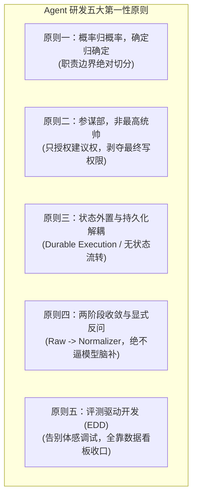

# 大模型能力边界与 Agent 架构研发第一性原则（工程实践与防衰变指南）

> **文档定位**：本文是企业 Agent 的设计原则和目标约束。原则需要通过真实模型、业务系统、身份认证、持久化和评测环境验证；示例工程只是原型，不代表这些能力已经达到生产级标准。

## 1. 前言：告别“全知全能”幻想，探寻 Agent 的长期可维护性

在 Agent 系统开发初期，团队往往容易陷入两个极端：
- **极端一：把大模型当作全知全能的神**，试图让大模型既做语义理解，又做精确算术、写数据库、做风控拦截甚至执行资金划扣；
- **极端二：遭遇模型抽风后全面退回传统系统**，认为大模型充满幻觉与不确定性，无法在企业严肃业务中落地。

这两个极端的根源，都在于**未能从底层数学与工程的第一性原理出发，看清大模型的真实物理边界**。

要让 Agent 系统具备长期可维护性、不至于随着业务复杂化而陷入天天打补丁的泥潭，核心前提是确立清晰的边界分工，并严格遵守架构第一性原则。

---

## 2. 大模型的物理本质与能力边界：它能做什么，绝对做不好什么？

大模型本质上是一个**基于海量数据统计概率的高维语义映射器（Next-Token Predictor over Latent Space）**。这就注定了它的能力边界具有鲜明的物理局限：

| 大模型天生擅长的（物理优势） | 大模型本质不擅长且无法根除的（物理死穴） |
| :--- | :--- |
| **模糊语义向结构化空间的投影** （多模态识别、自然语言解析、口语别名对齐、非结构化文本归纳） | **确定性精确计算与布尔逻辑推导** （大数浮点运算、密码学哈希比对、深度递归约束求解极易出错） |
| **广博常识的启发式联想** （头脑风暴、初步方案生成、类比推理、复杂商业情理权衡） | **事实的绝对保真（幻觉无法通过算法根除）** （概率采样的本质决定了只要在分布边缘，就必定存在非零概率的虚构） |
| **跨系统契约与自然语言的通用胶水** （将人类指令转化为特定 JSON，解释系统返回的报错信息） | **状态感知与时序一致性（模型自身是无状态的）** （上下文窗口不是内存，Token 堆得越长，注意力稀释与漂移越严重） |
| **长尾模糊语境的抗衰能力** （面对从没见过的长尾例外情况，能依靠常识做出八九不离十的解释） | **边界与权限的自我设防（模型无法自己守住安全）** （无法靠 Prompt 告诉模型“请你保密”来实现安全，攻击者总能构造越狱词） |

---

## 3. Agent 架构研发的五大第一性原则

为了让系统不因业务膨胀而崩溃，必须遵守以下五大底层架构原则：

### 原则一：概率归概率，确定归确定（Separation of Concerns）
* **核心原则**：大模型只负责**“概率性认知”**（意图识别、实体抽取、事实摘要和候选方案生成）；涉及金额、权限、状态、幂等和资金操作的确定性逻辑，应由模型外部的规则、数据库和受控业务服务负责。
* **反面教材**：在 Prompt 里写“如果金额大于 300 且城市是一线城市，请计算超标金额：申报金额减去 300”。这是灾难性的，大模型算减法可能算出各种莫名其妙的浮点误差。
* **工程正解**：模型只提取 `amount: 350.0`，由 Python 外部规则引擎计算 `350.0 - 300.0 = 50.0`。

### 原则二：大模型是参谋部，不是最高统帅（Advisory, Not Executive）
* **核心铁律**：严禁赋予大模型对核心资产、银行资金或底层数据库的“直接写权限”。
* **反面教材**：给 Agent 配置一个 `transfer_money(account, amount)` 工具，让模型根据对话直接发起转账。
* **工程正解**：
  1. Agent 只能拥有**只读查询权**和**预审建议权**（如生成 `reimbursement_draft`）；
  2. 核心支付与数据最终提交，必须经过人类最终确认（HITL）或受控系统的异步流水线；
  3. 即使模型被 Prompt 注入或输出错误，可信身份、下游授权和工具参数校验也应阻断越权操作。Prompt 本身不能承担安全边界。

### 原则三：状态外置化与持久化解耦（Durable Execution）
* **核心铁律**：不要把上下文窗口当作状态存储器，Agent 的生命周期不能绑定在内存或单个长连接进程中。
* **反面教材**：整个状态维护在一个 Python 对象的内存变量里，服务器重启、网络抖动或总监 3 天后才审批，整个流程丢失崩溃。
* **工程正解**：
  1. 将状态显式定义为结构化契约（如强类型 `ExpenseAgentState`）；
  2. 每次遇到异步等待或人机挂起，强制通过 Checkpointer 持久化到具备访问控制、加密、并发控制和备份能力的存储；
  3. 在正确处理版本、并发恢复、外部副作用和未知状态的前提下，工作进程崩溃后可以基于业务流程 ID 恢复，而不是简单依赖一个内存对象或本地文件。

### 原则四：两阶段收敛与显式反问设计（Two-Stage Normalization）
* **核心铁律**：绝不相信大模型的单次直接输出；遇到字段缺失时，系统必须提供显式反问分支，坚决不逼迫模型脑补。
* **反面教材**：定义了 `city` 为必须字段，用户只说了“帮我报销打车费 350 元”，大模型为了满足 Schema 强行捏造一个“上海”。
* **工程正解**：
  1. **阶段一（Raw Extraction）**：模型宽泛提取，允许关键字段为 `None`；
  2. **阶段二（Entity Normalizer）**：由代码将口语对齐为企业标准枚举（如“魔都” $\rightarrow$ “上海”）；
  3. 发现必填字段为空，显式阻断并生成反问信封，将流程置为 `WAITING_CLARIFICATION`，杜绝幻觉滋生。

### 原则五：评测驱动开发，告别“体感调试”（Evaluation-Driven Development, EDD）
* **核心铁律**：严禁依靠“我在网页聊天框里试了 3 次，感觉挺好”来推进 Agent 迭代；任何没有定量 Benchmark 的 Agent 项目最终必死于回归退化。
* **反面教材**：为了解决一个用户反馈的边缘 Bug，在 Prompt 里加了一句长提示词，结果暗中破坏了其他 80% 正常场景的提取稳定性，而团队对此浑然不知。
* **工程正解**：
  1. 固化一套涵盖正常、异常、越狱、缺字段等场景的黄金测试集；
  2. 无论是更新 Prompt、升级模型版本（如从 Flash 切换到 Pro）、还是增删工具，必须先跑一遍全量 Benchmark；
  3. 只有当准确率、拦截率、时延和成本指标不出现非预期劣化时，才允许上线。

---

## 4. 防架构衰变的“实习生”检验心智模型

在后续面对新需求和方案评审时，可以用以下一句话检查自己的设计是否健康：

> **“如果明天我把当前的大模型换成一个完全不同的模型，甚至换成一个偶尔会撒谎、算数会算错的实习生，我的核心系统会不会资损？流程会不会彻底瘫痪？”**

- **如果会瘫痪**：说明你在用大模型越俎代庖，扛了它不该扛的确定性职责，架构存在严重的单点脆弱性；
- **如果系统仍能限制影响范围**：能通过可信身份、工具授权、业务校验、幂等和人工接管阻止错误扩散，说明架构具备较好的可控性和演进基础。仍需通过故障演练和生产指标持续验证。

---

## 5. 本工程代码落地映射对照

本工程各模块提供了上述原则的原型映射，但以下映射不等于生产实现，也不替代安全、可靠性和合规验证：

| 原则 | 对应工程落地模块 |
| :--- | :--- |
| **原则一：概率归概率，确定归确定** | 示例将抽取和风控规则分开（[`agent/router.py`](../examples/enterprise_expense_agent/src/enterprise_expense_agent/agent/router.py)、[`governance/risk_checker.py`](../examples/enterprise_expense_agent/src/enterprise_expense_agent/governance/risk_checker.py)）；当前抽取逻辑仍是模拟实现，需用真实模型和错误样本验证 |
| **原则二：大模型是参谋部，非最高统帅** | 示例未开放直接支付工具，并展示了 `CREATE_DRAFT` 边界（[`governance/rbac.py`](../examples/enterprise_expense_agent/src/enterprise_expense_agent/governance/rbac.py)）；生产环境仍需接入可信身份、下游授权和审批审计 |
| **原则三：状态外置与持久化解耦** | 示例提供本地检查点接口（[`agent/checkpointer.py`](../examples/enterprise_expense_agent/src/enterprise_expense_agent/agent/checkpointer.py)）；本地 JSON 不能替代生产级数据库、加密、并发控制和恢复验证 |
| **原则四：两阶段收敛与显式反问** | 示例包含原始抽取、归一化和追问结构（[`agent/normalizer.py`](../examples/enterprise_expense_agent/src/enterprise_expense_agent/agent/normalizer.py)）；仍需补充跨字段一致性、事实核验和版本绑定 |
| **原则五：评测驱动开发 (EDD)** | 示例提供 9 个黄金用例入口（[`evals/test_cases.py`](../examples/enterprise_expense_agent/evals/test_cases.py)）；当前运行器主要比较动作标签，不能单独证明抽取准确率或生产可靠性 |

### 当前原型与生产实现的边界

当前示例用于说明模块边界和流程骨架，以下能力仍需单独建设和验证：真实模型调用、外部系统事务与幂等、审批人身份与签名、敏感数据保护、多进程恢复、工具调用审计，以及包含字段准确率和安全负例的评测门禁。

---

## 延伸阅读（企业级 Agent 架构思考三部曲）
- [第一篇：大模型与 Agent 的真实价值：与传统企业系统对比与工程选型指南](./agent_vs_traditional_systems.md)
- [第二篇：大模型能力边界与 Agent 架构研发第一性原则（防衰变指南）](./agent_design_principles.md)
- [第三篇：业务系统底座与 Agent 能力的辩证关系：巧妇能为无米之炊吗？](./business_systems_vs_agent_capabilities.md)
