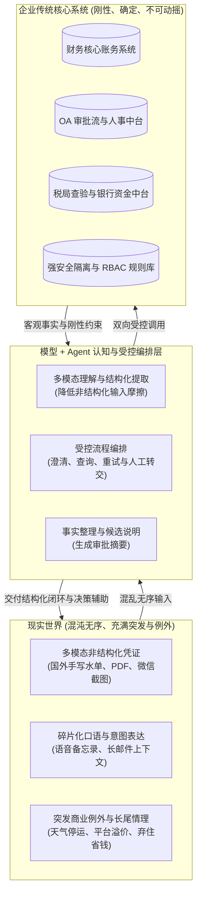
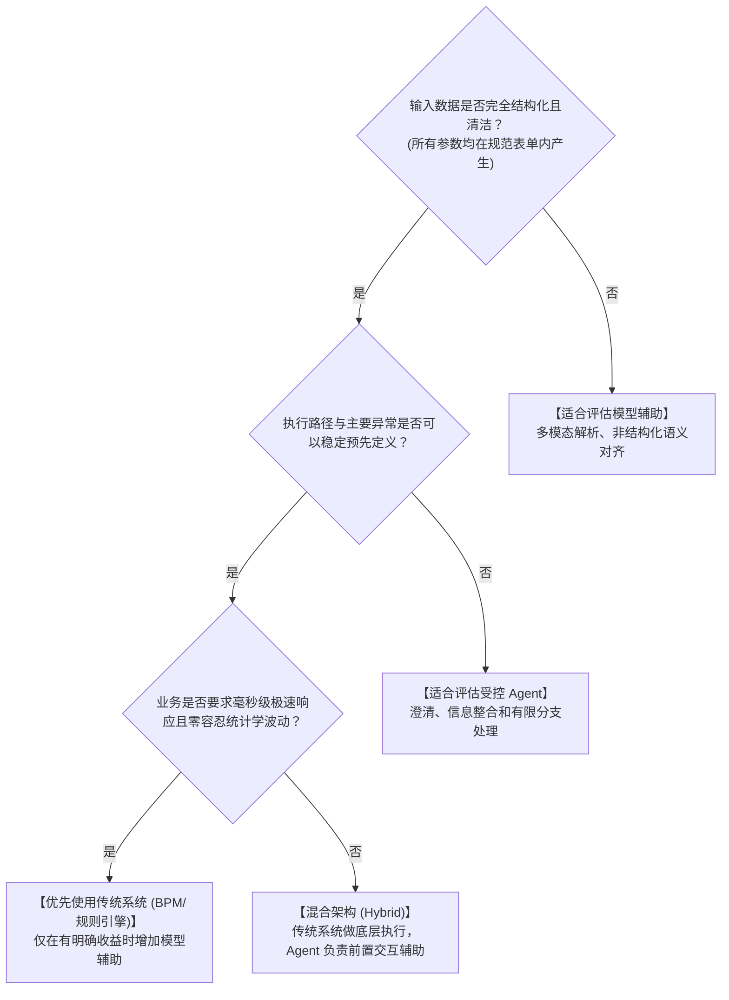

# 大模型与 Agent 的真实价值：与传统企业系统对比与工程选型指南

> **文档定位**：本文讨论企业 Agent 的适用边界和目标架构。文中的“可以”“适合”表示需要结合数据、风险和成本验证，不代表模型能够替代核心业务系统，也不代表示例代码已经达到生产级标准。

## 1. 核心问题背景：为什么常感觉“没看出 Agent 和传统系统的区别”？

在许多企业智能化尝试中，开发者容易产生一个强烈的困惑：
> *“发票查验、行程匹配、额度测算、权限控制、审批流转……这些逻辑在传统的 OA、ERP 或规则引擎（如 Camunda/Drools/泛微/飞书审批）里早已非常成熟。如果只是用大模型从一句话里提取城市和金额，然后再走一遍写死的业务规则，大模型和 Agent 的不可替代性究竟在哪里？”*

这种质疑是完全成立的，甚至切中了业界大量“伪 Agent”项目的要害：
如果一个业务场景满足：
1. **流程高度固定**（静态有向无环图 DAG，分支完全预先穷尽）；
2. **输入高度结构化**（员工严格在下拉菜单和格式化输入框中点选，发票扫码直接获得结构化字段）；
3. **规则完全封闭**（如 `金额 > 300` 找总监，`金额 <= 300` 自动放行）。

**在上述场景下，传统系统（前端表单 + 规则引擎 + 数据库事务）通常在确定性、成本、时延和审计可控性上更有优势。** 把原本几秒钟可以完成的结构化表单改成聊天对话框，可能引入额外的模型延迟、Token 成本和解析错误，只有在确实降低输入或处理成本时才有价值。

---

## 2. 传统系统与 Agent 面对的三类现实摩擦

传统系统的自动化更适合结构化、可预先定义的输入和流程。企业真实经营活动充满混乱、碎片与突发例外，系统在这些场景中会暴露出三类摩擦：

### 摩擦一：非结构化现实与刚性表单之间的“人工搬运代价”
* **传统系统的困境**：传统业务系统通常不能直接处理任意格式的非结构化材料。面对 5 张不同格式的供货凭证、微信群里领导的口头承诺截图、打车行程单 PDF，企业往往需要 OCR、人工坐席或专门的解析服务完成阅读、对账、核算，再输入表单字段。**结构化系统的自动化，可能把预处理成本转移给人工或外围工具。**
* **模型 + Agent 的价值**：大模型可以作为语义和多模态解析层，把口述、扫描件、长邮件或票据转换为候选结构化参数，再交给校验、补充和人工确认流程。解析结果仍需要经过置信度、事实来源和业务规则校验。

### 摩擦二：静态流程与受控的异常处理
* **传统系统的困境**：传统工作流是静态绑定的。如果报销时发现“缺少 OA 出差申请单”，传统系统只能机械抛错阻断并打回；如果第三方发票核验接口超时，流程直接崩溃。
* **模型 + Agent 的价值**：在固定工作流之外，可以增加有限的澄清、重试、替代查询和人工转交路径。
  - **受控降级**：主核验接口超时时，可以转为重试、查询备用接口或进入人工复核；OCR 只能帮助提取字段，不能替代税务或业务事实核验。
  - **跨系统协同建议**：发现缺少出差申请时，可以检索允许使用的相关信息并向员工提出补单建议；涉及新建或修改业务单据时，必须经过明确授权和人工确认。
  - **Agent 可以减少异常处理中的人工搬运，但不应默认拥有无限制的自主执行权。**

### 摩擦三：冰冷数值判断与复杂商业语境之间的距离
* **传统系统的困境**：规则引擎擅长执行明确的布尔比较（如 `金额 > 200` 即超标违规打回）。
  - 现实情况往往复杂：“当晚暴雨红色预警平台动态加价 2.5 倍，打车花费 350 元（超标 150 元）；但员工连夜赶回，**免除了当晚 600 元的酒店住宿费**，实际为公司节约了总支出”。
  - 传统系统对此一无所知，只会机械地拦截违规，迫使员工和财务在线下反复发邮件撕扯扯皮。
* **模型 + Agent 的价值**：大模型可以基于已核验的事实生成审批摘要，帮助审批人理解例外背景，但不应单独改变政策结论或替代审批责任：
  > *“系统综合研判：该笔交通费超标 150 元，但经核验当晚暴雨预警与平台溢价系数属实，且由于连夜返程直接免除了原定的 600 元酒店支出，实际使公司该次出差综合差旅成本降低约 450 元。建议予以合规特批。”*
  - **它可以减少信息搜集和整理工作，把审批人更多地留在事实确认和最终决策环节。**

---

## 3. 传统系统 vs 大模型+Agent 深度对比矩阵

| 评估维度 | 传统工作流系统 (BPM / 规则引擎) | 大模型 + 智能体架构 (LLM + Agent) | 核心技术分水岭 |
| :--- | :--- | :--- | :--- |
| **输入适应性** | 主要面向规范、结构化字段；非结构化材料通常需要额外解析 | 可以处理自然语言、多模态扫描件、语音口述等输入，但结果需要校验 | **非结构化语义与多模态解析** |
| **系统间协同** | 依赖强契约集成，接口变化需要适配、测试和发布 | 工具封装可以统一调用入口，但仍需要契约、认证、监控和回归测试 | **集成边界治理** |
| **执行路径** | 关键路径通常由工作流和规则预先定义 | 可在工作流允许的范围内进行澄清、查询和有限分支选择 | **受控适应性** |
| **异常处理** | 条件不满足时进入重试、补充或人工处理流程 | 可以识别异常并提出下一步建议，但高影响操作仍需授权或人工确认 | **异常协同** |
| **规则复杂度** | 例外增加会提高规则维护成本 | 模型可以辅助理解长尾语境，但政策边界和关键判断仍应结构化、可审计 | **语境理解与规则协同** |
| **交互心智成本**| 用户必须学习并适应系统的 50 个表单字段和流转逻辑 | 系统来适应用户的表达习惯和现实行为习惯 | **心智成本向系统侧转移** |

---

## 4. 架构定位：Agent 在企业 IT 架构中的真实生态位

必须明确：**Agent 不是为了替代传统数据库、ERP 或规则引擎，而是在底层业务系统与外部非结构化输入之间，充当受控的语义入口、信息整合和流程编排层**：

1. **下层（确定性底座）**：保留传统数据库、核心账务、身份与授权、幂等、审计和硬编码风控，守住企业资金安全与法务红线；
2. **中间层（Agent 智能层）**：负责多模态意图解析、跨系统信息整合、受控工具调用、澄清和审批摘要生成；
3. **上层（用户感知层）**：极大降低用户的交互摩擦，把繁重的表单录入转化为极简的目标交付。

---

## 5. 工程选型决策树：何时用传统系统？何时用 Agent？

### 优先使用传统系统：
* **流程高度固定且封闭**：如银行流水自动对账、员工标准打卡考勤、固定费率发票验真；
* **关键结果不允许由概率模型直接决定**：例如账务、支付、固定费率核算和权限判断；
* **已经有成熟的结构化输入和流程**，引入模型不能带来可验证的效率或体验收益；
* **高并发或低延迟要求已经接近现有系统边界**，测算后无法接受模型调用成本和尾延迟。

### 适合优先评估模型 + Agent：
* **非结构化与多模态壁垒**：涉及合同审核、多国单据混合报销、长邮件解析、多格式票据核验；
* **跨多异构系统长链路**：需要跨越多个系统完成信息搜集和参数转换，但工具边界、授权和关键路径仍需显式定义；
* **非结构化例外较多**：可以让大模型整理事实、提出候选方案和生成决策摘要，最终规则判断仍由系统或授权人员完成。

---

## 延伸阅读（企业级 Agent 架构思考三部曲）
- [第一篇：大模型与 Agent 的真实价值：与传统企业系统对比与工程选型指南](./agent_vs_traditional_systems.md)
- [第二篇：大模型能力边界与 Agent 架构研发第一性原则（防衰变指南）](./agent_design_principles.md)
- [第三篇：业务系统底座与 Agent 能力的辩证关系：巧妇能为无米之炊吗？](./business_systems_vs_agent_capabilities.md)
