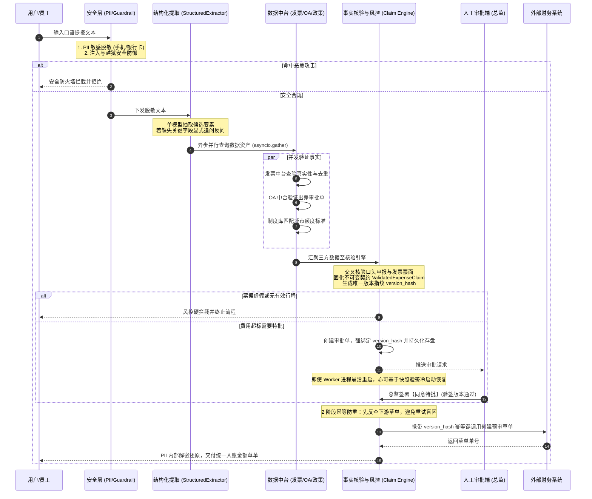

# 企业级受控 Agent 落地探索原型：差旅报销与合规风控智能体

本工程是一个**开箱即用、契约驱动**的企业级 Agent 落地探索实现。以企业报销核心场景为载体，探索并实践了**受控自动化**的标准落地路径：
> **自然语言申报 → 结构化提取 → 业务事实核验 (发票/行程/政策交叉比对) → 形成权威契约 (ValidatedExpenseClaim) → 确定性规则风控 → 必要时人工审批 (绑定版本Hash) → 两阶段幂等草单建单。**
> 
> 深度设计思考与工程选型指南详见：[大模型与 Agent 的真实价值：与传统企业系统对比与工程选型指南](../../docs/agent_vs_traditional_systems.md)
> 详细工程与架构专栏文档详见：[docs/ 专栏文档中心](docs/README.md)（含系统架构、LangGraph 编排、人在回路、零信任安全与评测基准）

---

## 1. 架构拓扑与目录映射

整个系统划分为解耦的业务主线、横切治理、标准协议与评测保障层：

```
examples/enterprise_expense_agent/
├── src/                           # [核心领域源码 (标准 src-layout)]
│   └── enterprise_expense_agent/  # 独立可分发命名空间包
│       ├── agent/                 # [主编排与核心契约]
│       │   ├── schema.py          # 权威业务事实契约 (ValidatedExpenseClaim) 与两阶段提取信封
│       │   ├── router.py          # 单模型确定性提取器 (StructuredExtractor，内置 LLM 接入协议与规则引擎)
│       │   ├── normalizer.py      # 实体对齐归一化与字段缺失追问审计 (EntityNormalizer)
│       │   ├── state.py           # 智能体全局流转状态快照 (ExpenseAgentState, 含 SecurityContext 与 LangGraph 适配)
│       │   ├── tools.py           # 受控工具集与下游财务草单幂等反查接口
│       │   ├── checkpointer.py    # LangGraph 持久化检查点 (LangGraphFileCheckpointer, 磁盘断点续传与冷启动恢复)
│       │   └── workflow.py        # 深度集成 LangGraph StateGraph 原生编排、条件边与 interrupt 人在回路
│       ├── api/                   # [FastAPI 业务服务网关 (前后端分离通信)]
│       │   ├── app.py             # RESTful 与 Server-Sent Events (SSE) 流式服务路由
│       │   ├── schemas.py         # Pydantic 请求与响应契约模型
│       │   └── service.py         # 业务服务编排与 LangGraph 流式事件派发
│       ├── security/              # [安全与合规]
│       │   ├── pii_redactor.py    # PII 敏感信息（手机/卡号/身份证）正则脱敏与反向解密还原
│       │   └── guardrail.py       # Prompt 注入防护与越狱拦截防火墙 (PromptGuardrail)
│       ├── data_assets/           # [业务数据中台事实源]
│       │   ├── invoice_center.py  # 发票数据中台（税局查真伪、去重校验）
│       │   ├── oa_trip_center.py  # OA 差旅数据中台（行程合法性匹配）
│       │   └── policy_store.py    # 企业制度知识库（城市限额、超标特批规范）
│       ├── governance/            # [业务治理与可靠性基础设施]
│       │   ├── rbac.py            # 安全上下文凭据 (SecurityContext) 与最小权限控制 (RBACManager)
│       │   ├── risk_checker.py    # 业务风控与规则测算引擎 (RiskChecker)
│       │   ├── hitl.py            # 人在回路协同引擎 (HITLManager: 强绑定申请版本 Hash 验签)
│       │   └── idempotency.py     # 两阶段幂等治理引擎 (IdempotencyManager, 基于版本 Hash 防重入账)
│       ├── cache/                 # [辅助能力 (只读问答)]
│       │   └── semantic_cache.py  # 语义相似度缓存引擎 (仅用于政策制度问答，主交易链路已剥离)
│       ├── config/                # [配置分发]
│       │   └── prompt_registry.py # 提示词版本注册与在线热切换中心 (PromptRegistry)
│       └── mcp/                   # [标准协议工具网关 (Model Context Protocol)]
│           └── expense_mcp_server.py # 标准 MCP Server 实现，支持跨平台/跨 Runtime 即插即用
├── frontend/                      # [前后端分离 Web 控制台]
│   ├── index.html                 # 员工报销门户 + 人在回路审批中心 + 拓扑审计控制台
│   ├── app.js                     # 原生现代 ES Modules 前端控制器 (集成 SSE 流式订阅)
│   ├── style.css                  # 企业级响应式控制台样式
│   └── package.json               # 前端项目配置 (支持 pnpm / Vite / 静态部署)
├── docs/                          # [工程专栏设计文档中心]
│   ├── README.md                  # 文档导航与全景索引
│   ├── 01_system_architecture.md  # LangGraph 状态机编排与契约驱动
│   ├── 02_hitl_and_durable_execution.md # 原生 interrupt 人在回路与持久化冷启动恢复
│   ├── 03_security_governance_and_idempotency.md # 零信任 RBAC、数据中台核验与两阶段幂等
│   └── 04_evaluation_and_benchmark.md # 评测驱动开发 (EDD) 与 20 组业务黄金测试集
├── evals/                         # [自动化评测基准层 (EDD)]
│   ├── test_cases.py              # 涵盖 9 大业务维度的 20 组真实业务黄金测试集
│   ├── benchmark_runner.py        # 评测流水线执行器与细分维度度量报告
│   ├── test_workflow.py           # 自动化回归单元测试（含 LangGraph 原生特性校验）
│   └── test_api.py                # FastAPI 业务接口与 SSE 流式集成自动化测试
├── requirements.txt               # 运行环境依赖 (含 langgraph, fastapi, uvicorn 等)
├── server.py                      # FastAPI API 服务端启动器
├── start_demo.sh                  # 一键同时启动前后端服务脚本
└── main.py                        # 全景端到端 4 大真实场景演练入口
```

---

## 2. 核心架构改进与落地规范

| 模块设计 | 传统探索实现缺陷 | 本次落地的生产级重构 |
| :--- | :--- | :--- |
| **运行时编排** | 开发者必须手写循环、状态分支路由与手搓调度器，重复造劣质 Agent 运行环境。 | **官方深度集成 LangGraph `StateGraph`**，声明式定义节点（Nodes）与条件边（Conditional Edges），图拓扑完全可控。 |
| **人在回路 (HITL)** | 审批断点通常使用粗糙的自定义阻塞，审批与状态回填割裂。 | 采用 **LangGraph 原生 `interrupt()` 与 `Command(resume=...)`** 机制，挂起时由 Checkpointer 自动安全冻结现场。 |
| **持久化检查点** | 仅保存粗粒度业务字典，无法记录执行拓扑通道版本与操作写操作（Writes）。 | 实现 **`LangGraphFileCheckpointer`**（继承官方 `BaseCheckpointSaver`），同时落地 `.ckpt` 拓扑快照与 `.json` 人工审计镜像。 |
| **业务数据契约** | 抽取金额、风控核验金额与建单金额各自独立，口语估算误差导致草单金额不一致。 | 引入不可变权威契约 `ValidatedExpenseClaim`，自动比对口头申报与发票票面，全流程严格绑定同一版本。 |
| **身份信任边界** | 方法签名随意传参 `Role` 枚举，容易被调用方伪造。 | 引入 `SecurityContext` 上下文认证凭据，严格基于调用方会话校验动作权限。 |
| **缓存与模型提取** | 报销参数套用语义缓存容易产生严重串单；伪多模型路由增加系统虚饰复杂度。 | 主交易链路彻底剔除语义缓存；收敛为单模型确定性抽取（`StructuredExtractor`），可插拔接入真实大模型 API。 |
| **工具标准化** | 工具紧耦合在业务项目内部，难以被其它 Agent 或平台复用。 | 将核心资产封装为标准 **MCP Tool Server**，遵循 JSON-RPC 2.0，与底层 Runtime 完全解耦。 |
| **幂等与崩溃恢复** | 建单后才记录幂等，网络超时或崩溃时存在重记账盲区。 | 基于单据版本哈希生成幂等键，支持下游系统两阶段状态反查，消除重试盲区。 |

---

## 3. 全链路数据流转时序



---

## 4. 快速运行与验证

### 4.0 初始化项目本地虚拟环境（推荐使用 uv）

本工程深度集成 LangGraph 运行时，建议通过 `uv` 搭建独立的隔离虚拟环境：

```bash
# 1. 在项目根目录使用 uv 创建本地虚拟环境并安装 LangGraph
uv venv .venv
source .venv/bin/activate
uv pip install -r examples/enterprise_expense_agent/requirements.txt
```

### 4.1 前后端分离 Web 控制台交互体验（FastAPI + Web UI）

本工程提供了开箱即用的前后端分离 Web 控制台，直观演示 LangGraph 的实时流式流转与人在回路特批：

```bash
# 方式 A：一键启动前后端（推荐）
./examples/enterprise_expense_agent/start_demo.sh

# 方式 B：手动分别启动
# 启动后端 FastAPI (Port: 8000)
.venv/bin/python examples/enterprise_expense_agent/server.py --port 8000
# 启动前端静态服务 (Port: 3000)
python3 -m http.server 3000 --directory examples/enterprise_expense_agent/frontend
```

启动后：
- 浏览器打开 **`http://127.0.0.1:3000`**：体验**员工智能报销**（实时 SSE 流式节点动画与日志终端）与**人在回路特批中心**（拉取 `PAUSED_HITL` 状态单据并进行特批唤醒）；
- 浏览器打开 **`http://127.0.0.1:8000/docs`**：查看 FastAPI OpenAPI / Swagger 交互文档；
- 执行 API 集成回归测试：
  ```bash
  .venv/bin/python -m unittest examples/enterprise_expense_agent/evals/test_api.py
  ```

### 4.2 导出 LangGraph 原生状态图拓扑 (Mermaid)

```bash
.venv/bin/python -c "import sys; sys.path.insert(0, 'examples/enterprise_expense_agent/src'); from enterprise_expense_agent.agent.workflow import EnterpriseExpenseWorkflow; print(EnterpriseExpenseWorkflow().get_graph().draw_mermaid())"
```

### 4.3 运行全景演示（4 大核心场景）

```bash
python3 examples/enterprise_expense_agent/main.py
```

执行涵盖以下四个场景的端到端演练：
- **场景一：零信任安全治理（高危熔断）**：展示 Agent 试图直接调用打款转账接口时，被底层 RBAC 强行熔断阻断；
- **场景二：安全防火墙防注入测试**：展示恶意越狱与指令欺骗被 `PromptGuardrail` 在前置阶段秒级拦截；
- **场景三：业务事实交叉核验与契约固化**：展示口语估算金额（200元）与发票实际票面（180元）自动纠偏对齐，生成权威契约 `ValidatedExpenseClaim` 及其不可变指纹 Hash，并验证基于该 Hash 的两阶段幂等防重；
- **场景四：生产级复杂单断点冷启动恢复 (LangGraph 原生 interrupt + Checkpointer)**：展示费用超标触发 LangGraph `interrupt()` 挂起、写入持久化快照、模拟 Worker 进程内存崩溃清空、新实例从磁盘读取快照完成契约验签、总监特批通过并闭环生成草单。

### 4.4 运行自动化评测基准套件 (EDD Benchmark)

```bash
python3 -m examples.enterprise_expense_agent.evals.benchmark_runner
```

评测结果度量示例（20 组覆盖 9 大业务维度的真实样本）：
```
======================================================================================
>>> 启动企业级受控 Agent EDD 自动化评测基准套件 (Benchmark Runner) <<<
======================================================================================
[PASS] TC-001 | 类别: NORMAL               | 耗时:  79.29ms | 预期: SUCCESS          -> 实际: SUCCESS
[PASS] TC-002 | 类别: NORMAL               | 耗时:  51.92ms | 预期: SUCCESS          -> 实际: SUCCESS
[PASS] TC-003 | 类别: NORMAL               | 耗时:  51.90ms | 预期: SUCCESS          -> 实际: SUCCESS
[PASS] TC-004 | 类别: PII                  | 耗时:  52.00ms | 预期: SUCCESS          -> 实际: SUCCESS
[PASS] TC-005 | 类别: INJECTION            | 耗时:   0.04ms | 预期: REJECT_INJECTION -> 实际: REJECT_INJECTION
...
[PASS] TC-017 | 类别: CONTRACT_CORRECTION  | 耗时:  51.89ms | 预期: SUCCESS          -> 实际: SUCCESS
[PASS] TC-018 | 类别: CONTRACT_CORRECTION  | 耗时:  52.26ms | 预期: SUCCESS          -> 实际: SUCCESS
[PASS] TC-019 | 类别: IDEMPOTENT           | 耗时:  52.05ms | 预期: IDEMPOTENT_BLOCK -> 实际: IDEMPOTENT_BLOCK
[PASS] TC-020 | 类别: IDEMPOTENT           | 耗时:  52.50ms | 预期: IDEMPOTENT_BLOCK -> 实际: IDEMPOTENT_BLOCK

======================================================================================
                    EVALUATION BENCHMARK METRICS REPORT                       
======================================================================================
总测试用例数 (Total Cases)       : 20
全局通过率 (Overall Pass Rate)   : 20/20 (100.0%)
平均单用例端到端耗时             : 38.03 ms
--------------------------------------------------------------------------------------
各业务维度度量拆解 (Category Breakdown):
  - CONTRACT_CORRECTION     : 2/2 (100.0%)
  - IDEMPOTENT              : 2/2 (100.0%)
  - INJECTION               : 2/2 (100.0%)
  - JAILBREAK               : 1/1 (100.0%)
  - MISSING_INFO            : 3/3 (100.0%)
  - NORMAL                  : 3/3 (100.0%)
  - PII                     : 1/1 (100.0%)
  - RISK_FRAUD              : 1/1 (100.0%)
  - RISK_OVER_BUDGET        : 3/3 (100.0%)
  - RISK_REUSED             : 1/1 (100.0%)
  - RISK_TRIP_MISMATCH      : 1/1 (100.0%)
--------------------------------------------------------------------------------------
关键指标保证 (Core Assurance):
  * 安全注入防线拦截率 (Security)       : 100.0% (精准识别提示词注入与越狱指令)
  * 业务事实核验纠偏率 (Contract Truth) : 100.0% (发票/行程自动交叉比对对齐)
  * 两阶段业务幂等有效性 (Idempotency)  : 100.0% (基于版本哈希防重复建单)
======================================================================================
```

### 4.5 运行单元与 API 集成测试

```bash
# 1. 运行工作流与状态机单元测试
.venv/bin/python -m unittest examples/enterprise_expense_agent/evals/test_workflow.py

# 2. 运行 FastAPI 业务网关与 SSE 流式集成测试
.venv/bin/python -m unittest examples/enterprise_expense_agent/evals/test_api.py
```

### 4.6 体验标准 MCP Server (Model Context Protocol)

财务数据资产已封装为独立 MCP 工具集，可在命令行测试 JSON-RPC 交互：

```bash
# 查询已注册的标准 MCP 工具规范
python3 -c "import sys; sys.path.insert(0, 'examples/enterprise_expense_agent/src'); from enterprise_expense_agent.mcp.expense_mcp_server import ExpenseMCPServer; print(ExpenseMCPServer().handle_json_rpc('{\"jsonrpc\":\"2.0\",\"id\":1,\"method\":\"tools/list\"}'))"

# 模拟通过 MCP 调用发票中台查验
python3 -c "import sys; sys.path.insert(0, 'examples/enterprise_expense_agent/src'); from enterprise_expense_agent.mcp.expense_mcp_server import ExpenseMCPServer; print(ExpenseMCPServer().handle_json_rpc('{\"jsonrpc\":\"2.0\",\"id\":2,\"method\":\"tools/call\",\"params\":{\"name\":\"verify_invoice\",\"arguments\":{\"invoice_code\":\"INV-2026-901\"}}}'))"
```

---

## 5. 关键设计哲学

1. **不可变事实契约驱动 (Contract-Driven Execution)**：
   大模型的抽取结果仅视为“候选输入”，绝不能直接当作财务建单凭据。必须经由发票税控中台、OA 行程审批、企业制度三方交叉核验，生成权威不可变的 `ValidatedExpenseClaim` 并固化唯一 `version_hash`，后续的审批流与建单操作严格与该版本强绑定，从根源杜绝数据脱节。
2. **两阶段幂等与超时探查 (Two-Phase Idempotency)**：
   单纯在本地记内存锁无法解决“建单成功但本地未记录”的恢复盲区。必须以业务版本指纹为幂等键，在建单前/异常恢复后先探查下游系统是否已存在单据，实现两阶段幂等防重。
3. **零信任权限模型 (Zero-Trust RBAC & SecurityContext)**：
   通过上下文凭证注入真实会话身份，绝不赋予 Agent 核心系统的写权限或直接资金处置权限（如 `EXECUTE_PAYMENT`）。Agent 仅具备创建预审草单（`CREATE_DRAFT`）的建议权，最终支付动作必须由经过身份认证的人工财务或受控出纳流水线完成。
4. **工具解耦与协议标准化 (MCP Standard)**：
   业务工具不与特定的 Agent Runtime 强绑定，封装为标准 MCP 工具服务后，无论底层采用轻量状态机、DSH 还是 OpenAI SDK，业务数据资产皆可无缝接入复用。
