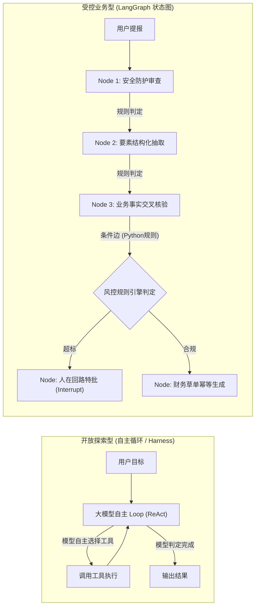
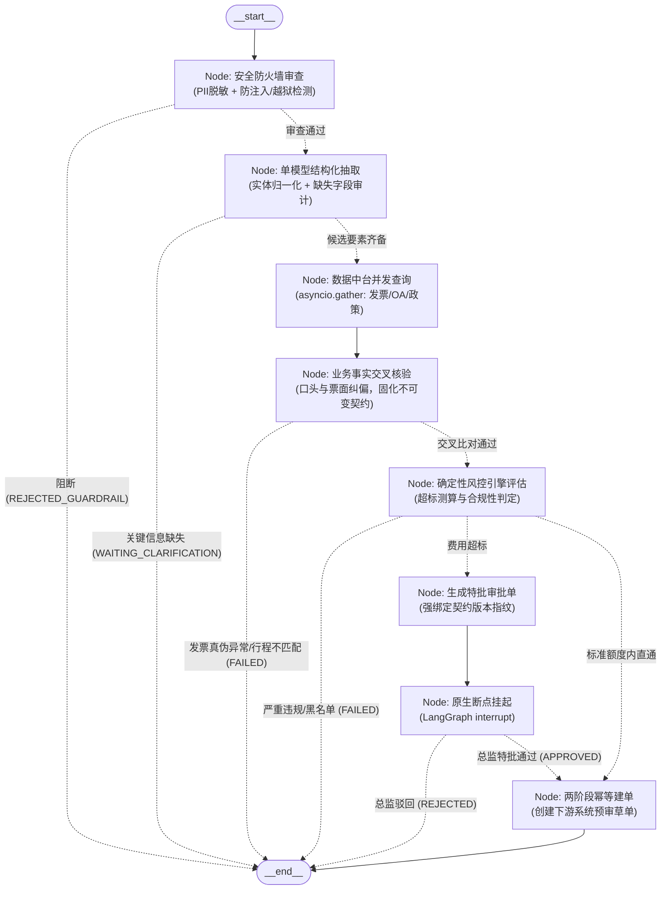
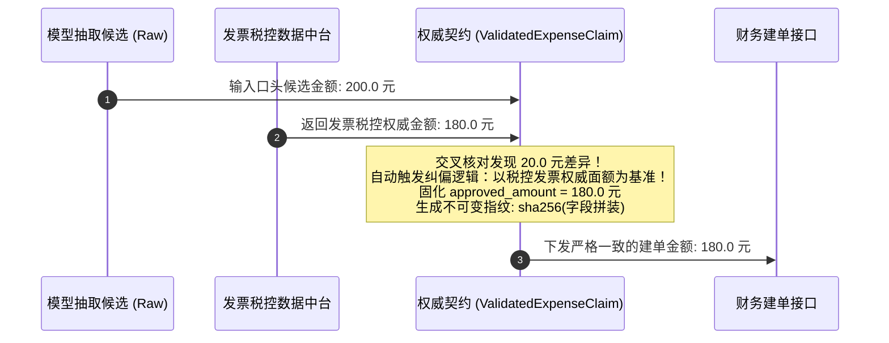

# 系统架构设计：LangGraph 状态机编排与契约驱动

> **文档定位**：深入解析差旅报销智能体（Enterprise Expense Agent）的全局拓扑设计、LangGraph 运行机制、不可变数据契约与受控条件路由逻辑。

---

## 1. 架构定位：为什么企业受控业务必须选择 LangGraph？

在构建面向企业内部财务、差旅风控、对账合规等核心业务的 Agent 时，开发者通常面临两种截然不同的架构路线：



### 1.1 核心痛点与选型分水岭
- **自主循环（如纯 ReAct / AutoGPT 模式）的致命缺陷**：
  在自主循环中，模型自己决定下一步调用哪个工具、何时结束循环。如果用于财务报销，模型可能因语义波动“自行跳过行程核验”直接尝试建单，甚至在发票金额不符时自行幻想出折中方案，彻底丧失流程边界控制。
- **LangGraph 的外部规则控制（Outside-in Control）**：
  开发者作为导演，定义好每一个节点（Node）与条件跳转边（Conditional Edge）。**大模型在其中退回到局部工人的生态位**——仅负责从用户口语提报中做结构化提取（`node_parse_intent`），而分支走哪条、是否拦截、何时挂起审批，均由外部硬规则（Python 纯函数判定）绝对锁死，模型无法自行篡改业务跃迁路径。

---

## 2. 状态机全景拓扑与控制流

系统完整编排实现见 `examples/enterprise_expense_agent/src/enterprise_expense_agent/agent/workflow.py:24`。

### 2.1 状态图流转拓扑（LangGraph StateGraph）



### 2.2 节点划分与职责规范

| 阶段 | 节点名称 (Node) | 职责与技术实现 | 异常/分支出口 |
| :--- | :--- | :--- | :--- |
| **Stage 1** | `security_guardrail` | 1. 正则识别手机号、银行卡、身份证并掩码存储至 `pii_vault`；<br/>2. `PromptGuardrail` 匹配注入模式与越狱指令。 | 恶意指令 -> 标记 `REJECTED_GUARDRAIL`，终止流程 |
| **Stage 2** | `parse_intent` | 1. 载入版本化 Prompt（`prompt_version`）；<br/>2. 确定性提取器（`ModelRouter`）提取候选 JSON；<br/>3. `EntityNormalizer` 归一化城市别名与审计缺失关键项。 | 缺失必要字段 -> 标记 `WAITING_CLARIFICATION`，反问追问 |
| **Stage 3** | `fetch_data_assets` | 异步并发 I/O（`asyncio.gather`），同时发起 3 项独立查询：<br/>• 发票中台验真去重；<br/>• OA 中台比对出差审批单；<br/>• 制度库检索城市消费上限。 | 耗时记录至 `io_duration_ms`（并发耗时通常缩短 60%+） |
| **Stage 4** | `cross_validate_claim` | 核心业务事实核验：比对口头申报与发票票面，自动纠偏，生成不可变权威契约 `ValidatedExpenseClaim` 并固化 `version_hash`。 | 发票查验失败或无匹配行程 -> 标记 `FAILED`，终止流程 |
| **Stage 5** | `governance_check` | 确定性规则引擎（`RiskChecker`）精确测算超标金额，判定是否需要人工特批。 | 违规拦截 -> 标记 `FAILED`；超标 -> 进入 `prepare_hitl` |
| **Stage 6** | `prepare_hitl` | 创建审批工单 `ApprovalTicket`，将工单强绑定当前单据的 `version_hash`，将状态标记为 `PAUSED_HITL`。 | 准备就绪后流转至 `wait_for_hitl` |
| **Stage 7** | `wait_for_hitl` | 触发 LangGraph 原生 `interrupt()` 挂起冻结；在恢复（`Command(resume=...)`）时验签审批人权限及单据版本哈希。 | 审批驳回 -> 标记 `REJECTED`；特批同意 -> 进入 `create_draft` |
| **Stage 8** | `create_draft` | 执行两阶段幂等检测：反查下游财务系统历史单据；调用接口创建预审草单并写入本地幂等完成态。 | 单据建单成功 -> 标记 `COMPLETED`，流程闭环 |

---

## 3. 全局流转状态与数据契约设计

### 3.1 全局流转状态：`ExpenseAgentState`
定义位于 `examples/enterprise_expense_agent/src/enterprise_expense_agent/agent/state.py:13`。

作为 LangGraph 的全局状态载体，`ExpenseAgentState` 采用类型化 `@dataclass` 组织，具备以下特点：
- **安全身份绑定**：内置 `SecurityContext`（调用方员工工号、会话 ID 及 RBAC 角色）；
- **快照追踪与可观测性**：内置 `trace_logs: List[str]`，记录从安全层到建单层的全链路执行日志；
- **状态流转标识**：包含 `INITIALIZED`, `REJECTED_GUARDRAIL`, `WAITING_CLARIFICATION`, `FAILED`, `PAUSED_HITL`, `APPROVED`, `COMPLETED` 等离散状态；
- **与 LangGraph 互通**：提供 `from_langgraph(res)` 和 `to_dict()` 方法，过滤 LangGraph 内部注入字段（如 `__interrupt__`），确保反序列化安全。

### 3.2 权威不可变事实契约：`ValidatedExpenseClaim`
定义位于 `examples/enterprise_expense_agent/src/enterprise_expense_agent/agent/schema.py:46`。

#### 为什么必须引入该契约？
在传统不规范的 Agent 系统中，大模型抽取的候选金额（例如员工随口说的“大概200元”）常常直接作为建单金额，而财务税控发票的真实面额（例如180元）仅作为文本记录，导致**建单金额与发票实际票面不一致**。



#### 版本哈希生成规则（`version_hash`）
`ValidatedExpenseClaim` 生成时，会将关键财务字段通过 SHA-256 算法计算出不可变的 64 位版本摘要：
```python
# 字段哈希拼装逻辑
raw_str = f"{employee_id}|{invoice_code}|{claimed_amount}|{invoice_amount}|{approved_amount}|{policy_limit}|{trip_record_id}"
version_hash = hashlib.sha256(raw_str.encode("utf-8")).hexdigest()
```
后续的人在回路审批单（`ApprovalTicket`）与幂等防重键（`idempotency_key`）均严格绑定该版本哈希，实现全链路防篡改与确定性防重。
