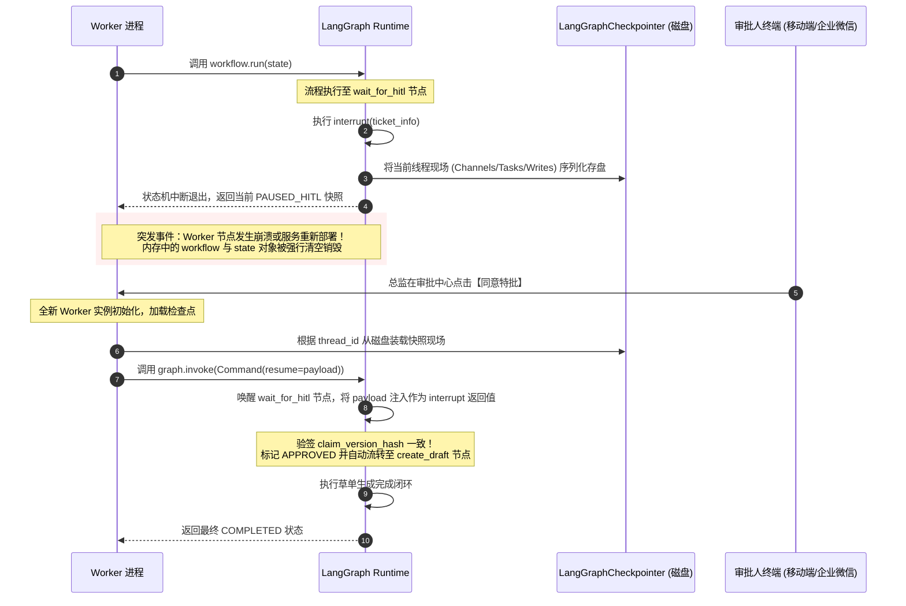
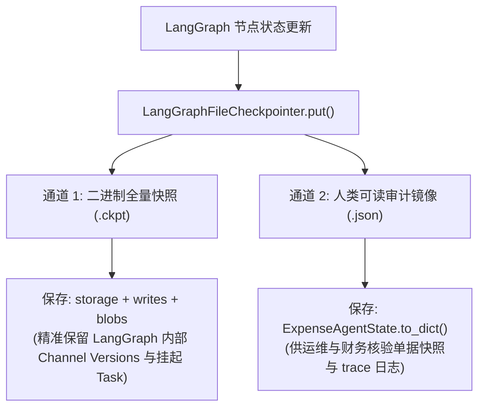

# 人在回路 (HITL) 与持久化冷启动恢复机制

> **文档定位**：深入解析基于 LangGraph 原生 `interrupt()` 的人在回路特批流、`LangGraphFileCheckpointer` 持久化引擎设计，以及生产环境中应对服务崩溃与版本防篡改的工程实践。

---

## 1. 业务背景：为什么严肃业务的人机协同不能靠简单轮询与内存挂起？

在企业财务审计与差旅报销中，费用超标需要由部门总监或财务领导审批。现实世界中的审批流程具有鲜明的工程特征：
1. **长事务周期（Long-Running Lifecycle）**：从员工提交申请到总监审核，中间可能间隔数小时甚至数天；
2. **进程易失性（Process Volatility）**：在此期间，后端的微服务实例或 Worker 进程可能因为宿主机迁移、发布升级或突发 OOM 重启数次；
3. **数据一致性风险（Data Consistency Risk）**：审批期间若缺乏版本强约束，申请数据如果在数据库底层被非法修改，总监审批通过的将变成被篡改后的单据。

如果使用基于内存的简单回调或 `while` 循环阻塞等待，服务一旦重启，整个审批上下文彻底丢失崩溃。

---

## 2. LangGraph 原生人在回路机制：`interrupt()` 与 `Command`

本工程全面采用 LangGraph 官方推荐的一等公民 HITL 机制。核心逻辑位于 `examples/enterprise_expense_agent/src/enterprise_expense_agent/agent/workflow.py:246`。



### 2.1 挂起实现：`interrupt()`
在 `node_wait_for_hitl` 中，通过调用 `interrupt()` 传递挂起上下文：
```python
# 触发 LangGraph 原生断点挂起
decision = interrupt({
    "ticket_id": ticket.ticket_id,
    "claim_id": claim.claim_id,
    "claim_version_hash": claim.version_hash,
    "overlimit_amount": state.risk_assessment.overlimit_amount,
    "reason": ticket.reason
})
```
此时 LangGraph 立即暂停后续节点的流转，将当前节点标记为挂起任务，并将状态安全持久化到绑定的 Checkpointer 中。

### 2.2 恢复实现：`Command(resume=...)`
当外部审批回调到达时，无需重新从起点运行流程，直接向指定 `thread_id` 发送恢复指令：
```python
payload = {
    "operator": approver,
    "approved": approved,
    "comment": comment
}
# 通过 Command(resume=...) 唤醒挂起节点
res = self.graph.invoke(Command(resume=payload), config={"configurable": {"thread_id": thread_id}})
```
LangGraph 自动将 `payload` 作为此前 `interrupt()` 调用的返回值注入到执行上下文，流程沿着预设的条件边无缝继续流转。

---

## 3. 双轨持久化引擎：`LangGraphFileCheckpointer`

实现代码位于 `examples/enterprise_expense_agent/src/enterprise_expense_agent/agent/checkpointer.py:34`。

为了在满足 LangGraph 官方 `BaseCheckpointSaver` 严格规范的同时，兼顾生产环境运维审计需求，本工程设计了**二进制通道快照 + JSON 审计镜像**的双轨存储机制：



### 3.1 核心特性
1. **完整通道与 Task 恢复**：
   通过保存 `storage`、`writes` 和 `blobs`，冷启动后的新实例调用 `graph.get_state(config)` 时，能够完整识别当前挂起节点为 `('wait_for_hitl',)` 以及挂起附带的 `Interrupt` 对象；
2. **序列化安全白名单**：
   针对 LangGraph 1.2+ 的 MsgPack 序列化安全限制，配置了 `JsonPlusSerializer` 安全白名单：
   ```python
   ALLOWED_MSGPACK_MODULES = [
       ("enterprise_expense_agent.governance.rbac", "Role"),
       ("enterprise_expense_agent.governance.rbac", "SecurityContext"),
       ("enterprise_expense_agent.agent.schema", "ClaimStatus"),
       ("enterprise_expense_agent.agent.schema", "ValidatedExpenseClaim"),
       ("enterprise_expense_agent.governance.risk_checker", "RiskAssessment"),
       ("enterprise_expense_agent.governance.hitl", "ApprovalTicket"),
       ("enterprise_expense_agent.agent.state", "ExpenseAgentState"),
   ]
   ```
   杜绝不安全的反序列化风险与运行时告警。

---

## 4. 审批安全：强绑定版本哈希（`expected_version_hash`）防篡改

在审批恢复阶段，最危险的安全隐患是：**“审批人在前台看到的是版本 A，但在审批期间底层数据被旁路脚本恶意篡改为了版本 B，审批通过后导致巨额资金流失”**。

本工程通过不可变版本指纹强制验签解决该隐患：
1. **工单创建时绑定**：
   在 `node_prepare_hitl` 中创建特批工单时，工单记录当前的 `claim_version_hash`；
2. **恢复执行时硬核校验**：
   位于 `examples/enterprise_expense_agent/src/enterprise_expense_agent/governance/hitl.py:108`：
   ```python
   if expected_version_hash and ticket.claim_version_hash != expected_version_hash:
       raise SecurityViolationError(
           f"审批单版本验签失败！工单绑定版本: {ticket.claim_version_hash}，"
           f"当前恢复版本: {expected_version_hash}。存在并发修改风险，拒绝流转！"
       )
   ```
   若单据发生哪怕 1 分钱的金额改动或发票代码变更，`version_hash` 将发生改变，状态机立即触发安全熔断拒绝流转。
