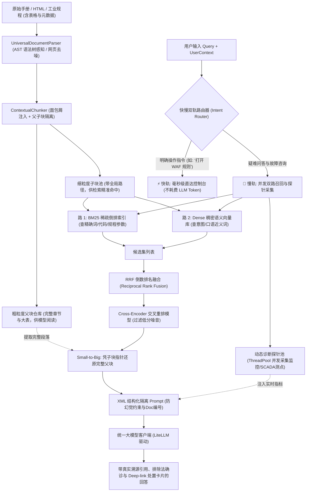

# 现代知识库与控制台 Agent 全链路架构示例 (Knowledge QA & Console Agent)

> 针对企业级复杂文档、控制台问答与“问答即操作（Text-to-Action）”以及严苛垂直行业规程场景的前沿架构参考实现。

---

## 一、 业界前沿方案深度调研 (SOTA Survey)

在构建生产级知识问答与控制台智能体时，目前国际头部团队（Anthropic、Cloudflare、Google Cloud、Inkeep/Mintlify）已淘汰早期粗糙的“纯向量库召回 + 直接拼 Prompt”天真 RAG 架构，转向以下前沿落地形态：

### 1. Anthropic Contextual Retrieval (上下文增强检索)
- **核心痛点**：传统固定字数切片（Chunking）会把文档硬切成几百字的片段，导致段落丢失了代词指代、章节归属和上下文，造成约 50% 的检索召回失败。
- **SOTA 解法**：在数据入库阶段，为每一个细粒度切片头部注入**上下文面包屑与概括性前缀（Contextual Prefix）**，并对带上下文的文本同时构建 BM25 索引和向量 Embedding。
- **权威评测结果**：Anthropic 官方工程实验表明，**上下文 BM25 + 上下文向量检索** 可将检索失败率降低 **49%**；叠加 **Rerank 重排模型** 后，检索失败率累计降低 **67%**。

### 2. Cloudflare Docs AI 与 控制台操作直达 (Text-to-Action)
- **核心落地形态**：Cloudflare 将其官方文档（结构化 Markdown/MDX）与 Cloudflare Dashboard 控制台深度打通。
- **双路输入设计**：
  - 文档入库时提取 YAML Frontmatter，将控制台路径（`action_url`）、权限要求（`permissions`）和 CLI 命令（`wrangler ...`）固化为元数据；
  - 用户提问时，不仅生成排查方案，末尾直接附带**控制台一键直达链接（Deep-link）**与终端命令，实现“从阅读到操作”的零跳转。

### 3. Google Cloud Console (Gemini Cloud Assist) 快慢双轨机制
- **底层架构**：依托 Vertex AI Search 工业级检索基础设施（语义向量 + PageRank + 工业级交叉重排）。
- **快慢双轨分流**：
  - 针对高频明确的页面查找（如“查看 IAM 权限”、“查看 VPC 路由表”），走前端倒排或本地缓存的 **Command Palette (Cmd+K) 快轨**，在 1ms 内直接跳转；
  - 针对“为什么收到 502 报错”、“如何配置跨域”等复杂业务场景，才流转至慢轨大模型生成。

### 4. 严苛垂直行业（能源电力与特种装备）工业规程会诊
- **行业痛点**：在国家标准/行业标准（如 DL/T 722 变压器油中气体分析、DL/T 596 预防性试验）中，表格数据密集、参数限值严苛、且涉及多部规程交叉会诊。静态手册必须与现场 SCADA 实时测点数据联动，才能完成故障根因确诊。

---

## 二、 系统架构设计

本项目完整复刻并集成了上述 SOTA 方案的核心思想，包含数据离线治理、双路混合召回、精排过滤、快慢双轨分流、动态探针并发执行、以及多租户前置物理硬隔离：



---

## 三、 深度设计文档体系 (Docs Index)

针对各核心子系统的详细设计与工程实践，项目配套了完整的专题白皮书：

- [技术文档库导航与概览](docs/README.md)
- [01. 全链路系统架构设计与核心生命周期](docs/01_system_architecture.md)：天真 RAG 缺陷深度剖析、分层架构图、组件交互时序图与强类型契约模型。
- [02. 数据摄取与上下文检索深度实践](docs/02_ingestion_and_contextual_retrieval.md)：CommonMark AST 语法树解析、HTML DOM 去噪、Anthropic 面包屑注入、Small-to-Big 父子索引、RRF 排名融合与 Cross-Encoder 重排。
- [03. 控制台快慢双轨路由与 Orchestrated Tool-RAG 闭环](docs/03_dual_track_routing_and_tool_rag.md)：毫秒级快轨直达分类器、线程池并发动态诊断探针编排、XML 提示词工程与 LiteLLM 统一模型驱动。
- [04. 企业级多租户与 RBAC 物理硬隔离架构](docs/04_multitenancy_and_rbac_security.md)：事后过滤安全漏洞剖析、物理前置硬过滤（Hard Pre-filtering）机制、SQLite FTS5 原生检索与 BLOB 向量持久化。
- [05. 自动化质量评测基准与复杂场景压测](docs/05_evaluation_and_complex_stress_benchmarks.md)：离线基准与 CI 门禁、DL/T 722 规程阶段验证、跨规程多跳联合推断与三比值数值计算极限压测实测。

---

## 四、 核心模块实现对照表

| 模块目录 | 核心类/文件 | 解决的技术痛点与工程设计 | 代码引用位置 |
| :--- | :--- | :--- | :--- |
| `src/ingestion/` | `UniversalDocumentParser`<br>`MarkdownASTParserAdapter`<br>`HTMLTrafilaturaParserAdapter` | **防止内容被“切坏”与噪音污染**：基于 CommonMark 语法树切分，避免代码块内伪标题误判；提取 HTML 正文并过滤导航/广告/页脚；提取 Frontmatter 操作元数据。 | `examples/knowledge_qa_agent/src/ingestion/parser.py:12` |
| `src/ingestion/` | `ContextualChunker` | **消除指代歧义与保护表格原子性**：实现 Anthropic 面包屑路径注入；表格作为不可分割原子块；建立 Small-to-Big 父子块索引。 | `examples/knowledge_qa_agent/src/ingestion/chunker.py:9` |
| `src/ingestion/` | `IndustrialNetworkLoader` | **垂直工业规程数据拉取**：支持网络标准规程拉取与本地容灾镜像加载。 | `examples/knowledge_qa_agent/src/ingestion/network_loader.py:12` |
| `src/retrieval/` | `BM25Retriever`<br>`DenseSemanticRetriever`<br>`HybridRRFRetriever` | **解决词汇鸿沟与语义漂移**：BM25 精准锁定专有名词和私有错误码（如 `ERR_GATEWAY_502`、`C2H2`）；向量模型识别口语化同义意图；RRF 算法无偏融合两路排名。 | `examples/knowledge_qa_agent/src/retrieval/bm25.py:10`<br>`examples/knowledge_qa_agent/src/retrieval/hybrid.py:10` |
| `src/retrieval/` | `CrossEncoderReranker` | **去噪与精炼**：对 Top-N 候选文本进行 Query-Doc 交叉注意力计算，融合词面、面包屑分类与核心实体加权，过滤弱相关切片。 | `examples/knowledge_qa_agent/src/retrieval/reranker.py:10` |
| `src/storage/` | `SQLiteLocalStore` | **本地持久化与冷启动**：单文件 SQLite 磁盘持久化，集成原生 FTS5 倒排索引与 Float32 向量 BLOB 序列化，支持无重依赖本地极速冷启动。 | `examples/knowledge_qa_agent/src/storage/sqlite_store.py:15` |
| `src/navigation/` | `IntentRouter` | **控制台操作提速与探针编排**：识别用户操作意图，在 1ms 内输出 Deep-link 与权限；慢轨时编排待执行的实时系统诊断探针。 | `examples/knowledge_qa_agent/src/navigation/router.py:11` |
| `src/agent/tools/` | `DiagnosticToolRegistry` | **动态体检与现场确诊**：管理云原生与工业 SCADA 遥测探针，通过多线程池异步并发采集实时健康指标。 | `examples/knowledge_qa_agent/src/agent/tools/diagnostic_registry.py:17` |
| `src/agent/` | `KnowledgeAgentEngine`<br>`LiteLLMClient` | **防幻觉与引用溯源**：顺着子块指针还原完整父块，组装 XML 结构化隔离提示词，基于排除法推理生成带 `[Doc N]` 引用和一键处置卡片的答案。 | `examples/knowledge_qa_agent/src/agent/qa_engine.py:10`<br>`examples/knowledge_qa_agent/src/agent/llm_client.py:62` |

---

## 五、 快速上手与场景演练

本项目使用 Python 标准库与零冗余架构编写，支持零外部依赖开箱即用，亦可一键升级为工业级深度学习生产栈：

### 1. 运行方式
```bash
# 进入示例项目目录
cd examples/knowledge_qa_agent

# 模式 A: 零额外依赖即开即测 (默认使用系统内置的 FSM 状态机与 64 维空间模拟器)
./run_demo.sh

# 模式 B: 一键升级为工业级全套生产栈 (AST 语法树 + fastembed ONNX 深度学习向量 + trafilatura 网页去噪 + litellm)
pip install -r requirements.txt
./run_demo.sh
```

> **全链路自动感知与平滑降级机制**：
> 1. 检测到 `markdown-it-py` 与 `trafilatura`，自动激活高精度 AST 与网页主体去噪；
> 2. 检测到 `fastembed`，自动加载智源开源模型 `BAAI/bge-small-zh-v1.5`（512 维神经网络嵌入）；
> 3. 未安装外部库时，无缝回退为内置纯 Python 零依赖模块，保障任何裸机环境 100% 可用。

### 2. 演练展示的七大核心场景 (`main.py`)
1. **场景一：数据切片对比**
   - 现场对比盲目固定字数切片（表格被腰斩、表头丢失、无业务归属）与 Anthropic Contextual Chunking 的巨大质量差异。
2. **场景二：检索机制对决**
   - 分别输入精确错误码（`ERR_GATEWAY_502`）与口语化近义词（`跨域同源访问报错`），直观验证纯 BM25、纯向量和混合 RRF 召回的互补优势。
3. **场景三：控制台双轨路由**
   - 展示毫秒级快轨（`打开 WAF 规则` 直接返回 `/dashboard/security/waf/custom-rules`）与慢轨复杂知识问答的智能分流。
4. **场景四：端到端业务闭环 —— 动态诊断探针并发调用与故障精准确诊 (Orchestrated Parallel Tool-RAG)**
   - 模拟用户线上报错 `ERR_GATEWAY_502`；
   - 意图路由器动态编排 4 项系统探针（源站服务存活、SSL 证书状态、网关实时错误率、防火墙拦截）；
   - 并发双路执行（静态手册检索 || 线程池并发执行底层探针）；
   - 大模型在 XML 上下文中执行严格排除法，确诊故障根因（源站证书过期导致握手失败），并在末尾输出一键更新证书的控制台直达与 CLI 处置卡片。
5. **场景五：本地持久化与冷启动**
   - 演示将所有元数据、向量与文本切片写入本地单一 `data/knowledge_base.db` 文件，并在清空内存后实现秒级冷启动与原生 FTS5 磁盘全文检索。
6. **场景六：HTML 网页直接输入与去噪治理**
   - 现场输入充斥着导航栏促销（`<nav>`）、侧边栏推荐（`<aside>`）与备案版权（`<footer>`）的原生 HTML 网页；
   - 演示正文与控制台 ActionLink 的精准去噪抽取，并与下游切片引擎无缝复用。
7. **场景七：企业级多租户与 RBAC 物理硬隔离**
   - 演示外部租户访客身份请求时，私有审计数据在 BM25 检索与 SQLite SQL 查询最底层被物理硬拦截（泄露数为 0）；
   - 演示授权审计员正常召回私有业务知识，彻底杜绝越权信息泄露。

---

## 六、 自动化质量评测基准与垂直工业验证套件

为了防止后续业务代码与算法参数迭代造成质量与路由静默劣化，项目内置了完整的多层次评测套件：

### 1. 通用质量评测基准 (`scripts/eval_benchmark.py`)
```bash
# 运行 35 个技术用例评测，自动生成快照写入 eval_history/ 并导出 reports/benchmark_report.md
python3 scripts/eval_benchmark.py --report --tag baseline

# 自动对比当前改动与上一版本快照，输出指标涨跌与用例退化看板
python3 scripts/eval_benchmark.py --diff

# 若检测到用例退化则阻断 CI 流水线 (退出码 1)
python3 scripts/eval_benchmark.py --diff --fail-on-regression

# 评测大模型离线批量生成的合成用例集
python3 scripts/eval_benchmark.py --dataset eval_data/synthetic_sample.jsonl
```

### 2. 垂直行业规程全链路阶段验证 (`scripts/verify_industrial.py`)
依据国家标准《DL/T 722 变压器油中溶解气体分析和判断导则》进行端到端验证：
```bash
python3 scripts/verify_industrial.py
```
- **阶段一（非标清洗）**：解析 7 个规程章节，抽取 3 个系统操作入口（PASS）；
- **阶段二（结构切片）**：生成 7 个父块与 15 个子块，规程限值表格保持原子性（PASS）；
- **阶段三（混合检索）**：Hit@1=100.0%, Hit@3=100.0%, MRR=1.000（PASS）；
- **阶段四（端到端确诊）**：路由准确率 100.0%, 溯源率 100.0%, 安全拒答率 100.0%（PASS）；
- 自动生成 [工业规程阶段完成验证报告](reports/industrial_verification_report.md)。

### 3. 高难度复杂工业压力场景极限评测 (`scripts/verify_complex_stress.py`)
针对多部规程交叉多跳、数值计算与强干扰负样本进行极限压测：
```bash
python3 scripts/verify_complex_stress.py
```
- **多跳联合推断**：联合 DL/T 722 与 DL/T 596 规程，确诊电弧放电与绝缘纸受潮复合故障；
- **数值换算与编码推导**：对实测特征气体浓度动态换算三项比值，推导出改良三比值编码并查表判定故障；
- **强干扰负样本抗混淆**：严格区分 330kV 主变（150 uL/L）与互感器 PT/CT（10 uL/L）注意值限值；
- **新旧版本修订仲裁**：依据时效性元数据仲裁现行有效规程条款；
- 自动生成 [复杂工业压力场景评估报告](reports/complex_stress_report.md)（实测通过率 6/6 100.0%）。

---

## 七、 生产级第三方生态与持久化选型

当项目从原理原型走向更大规模的生产部署时，推荐按需引入以下生态组件：

| 领域分类 | 推荐开源库 | 优势与适用场景 |
| :--- | :--- | :--- |
| **轻量 AI 运行栈** | **fastembed** | 基于 ONNX Runtime 的纯 CPU 向量化库，包体仅几十 MB，比 PyTorch 轻量 90%。 |
| | **flashrank** | 基于 ONNX 的轻量级 Rerank 模型，在 CPU 上重排 50 个候选仅需 20ms。 |
| **文档解析 (ETL)** | **markdown-it-py** | CommonMark 严格语法树解析，消除代码块与表格误切。 |
| | **trafilatura** | 业内标杆的网页 DOM 核心正文去噪抽取库。 |
| | **docling** | IBM 开源，对复杂 PDF、跨页表格与双栏排版还原为 Markdown 最精准。 |
| **持久化存储** | **SQLite + FTS5** *(内置已实现)* | 单文件 `.db`，零外部依赖，ACID 事务，原生 BM25 检索，Float32 BLOB 向量存储。 |
| | **LanceDB** *(推荐首选)* | 现代嵌入式向量库标杆，基于 Apache Arrow 列式存储，原生支持向量+全文混合检索。 |
| | **Embedded Qdrant** | 进程内嵌入式运行，支持复杂多租户过滤与 HNSW 索引。 |
