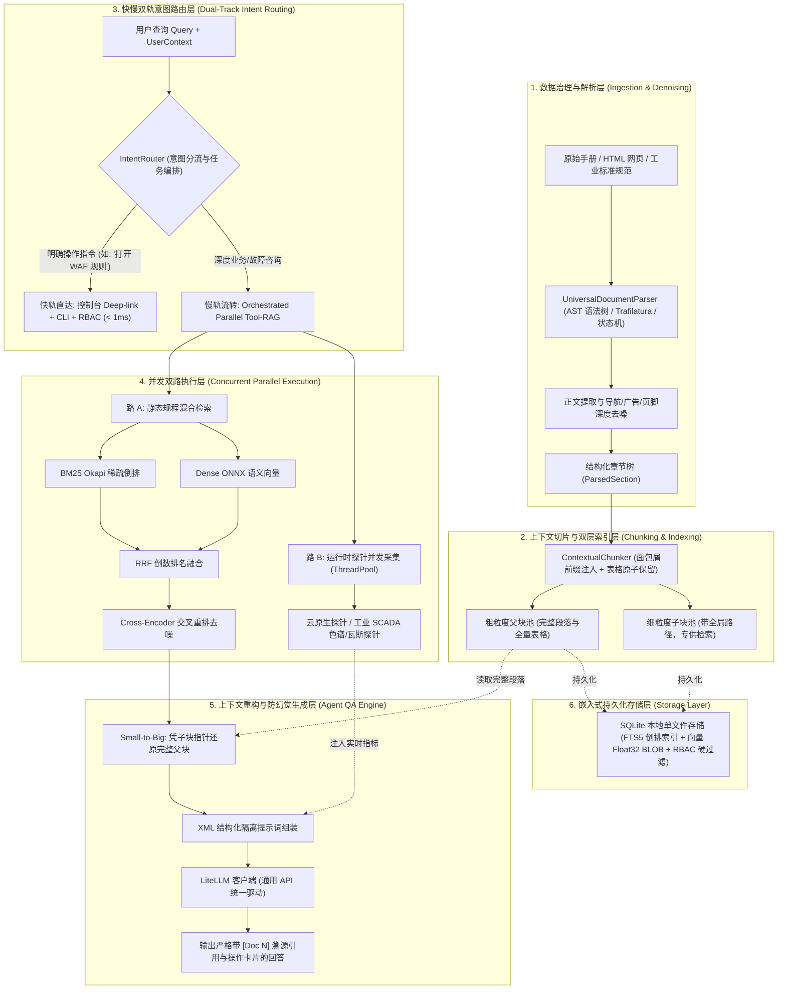
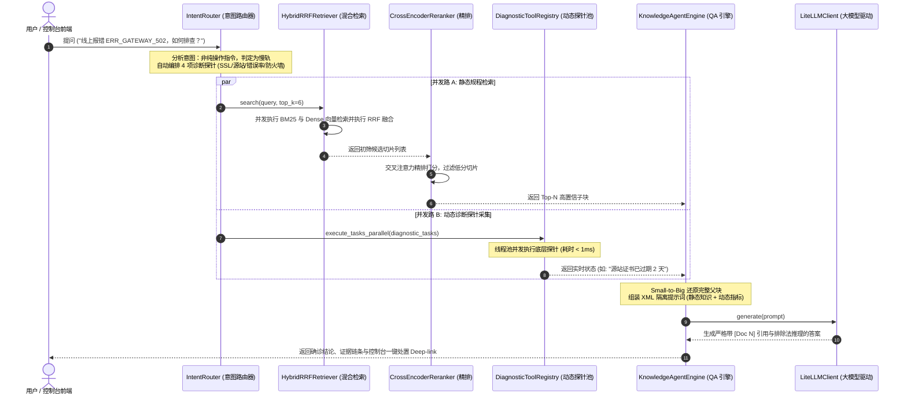

# 全链路系统架构设计 (System Architecture Design)

## 一、 业务背景与问题定义

在企业级控制台运维与垂直行业规程咨询（如能源电力设备维护、云平台故障排障）场景中，早期的“天真 RAG（Naive RAG）”架构（纯向量数据库切片召回 + Prompt 直接拼接）在落地时面临一系列致命的工程痛点：

1. **切片上下文断裂与指代丢失**：固定字数（如 300~500 字）切分破坏了段落语义完整性，段落中的“该参数”、“本设备”丢失了上下文标题路径，导致检索阶段召回失败率超过 50%。
2. **结构化表格被腰斩**：技术规范与诊断手册中关键的指标限值表、三比值编码表被硬性切断，表头与数值分离，导致大模型读取到残缺数据后产生严重幻觉。
3. **盲目调用大模型造成延迟惩罚与成本浪费**：在实际运维控制台中，超过 40% 的用户搜索仅仅是为了“找功能入口、查配置菜单”。这类需求耗费数秒调用大模型是严重的资源浪费。
4. **纸上谈兵与缺乏实时确诊能力**：纯静态知识问答只能复述手册中的排查建议，无法结合线上运行态指标（如源站网络连通性、实时证书有效性、变压器在线油色谱与瓦斯继电器状态），无法给出确凿的根因判定。
5. **多租户与合规隔离缺失**：简单在检索后（Post-filtering）过滤机密数据，既浪费算力，又存在通过 Prompt 注入或侧信道推断越权敏感信息的安全隐患。

本项目构建了端到端的工业级 SOTA 架构，针对性解决了上述所有工程挑战。

---

## 二、 分层系统架构设计

系统整体采用模块化分层解耦架构，自底向上分为六大核心层：

### 1. 数据治理与解析层
负责将 Markdown、MDX、HTML 等异构非标文档解析为统一的标准章节契约 (`ParsedSection`)。核心在于语法树解析（避免伪标题误判）、DOM 去噪（剔除网页导航栏、广告、备案等噪音）以及 Frontmatter 元数据提取。

### 2. 上下文切片与双层索引层
落地 Anthropic Contextual Retrieval 理念。针对每一细粒度检索切片动态注入多级面包屑前缀（例如 `[上下文路径: 变压器规程 > 5. 故障研判 > 5.1 三比值法]`）。建立 Small-to-Big 父子切片关联，粗粒度父块保留大段落和完整表格，细粒度子块负责高精准命中。

### 3. 快慢双轨意图路由层
对齐 Cloudflare Dashboard 和 Google Cloud Assist 理念。对于查找配置菜单、查看日志入口等高频指令，在 1ms 内走**快轨（Fast Path）**直接返回 Deep-link 路径与权限，不调用大模型；对于疑难问题走**慢轨（Slow Path）**，并根据问题类型动态编排需要调用的底层实时诊断探针。

### 4. 并发双路执行层
在慢轨执行时，静态知识库检索与底层动态探针通过多线程池**并发异步执行**。静态检索通过 BM25 与 Dense 向量召回候选集，经 RRF 排名融合后由 Cross-Encoder 精排过滤；底层探针采集实时系统健康度或 SCADA 工业测点遥测数据。

### 5. 上下文重构与防幻觉生成层
根据精排保留的子块指针，顺藤摸瓜从父块仓库中还原完整章节正文（Small-to-Big 还原）。组装 `<system_instructions>`、`<context>`、`<runtime_diagnostics>`、`<question>` 严格 XML 边界隔离的提示词。模型执行排除法推理，严格标注 `[Doc N]` 引用，输出附带一键处置卡片的最终答案。

### 6. 嵌入式持久化存储层
使用单文件 SQLite 数据库持久化切片正文、面包屑、向量 BLOB 和 FTS5 原生全文倒排索引。支持完全离线运行、秒级冷启动与多租户 SQL WHERE 级别的前置物理阻断。

---

## 三、 核心生命周期与交互时序

以下展示慢轨查询（结合动态诊断探针）的完整端到端生命周期：

---

## 四、 核心数据契约与接口模型

所有模块之间均通过强类型数据契约进行交互，避免隐式字典传递带来的不稳定性：

| 数据模型类名 | 归属生命周期阶段 | 关键属性与核心用途 | 代码引用位置 |
| :--- | :--- | :--- | :--- |
| `ActionLink` | 阶段 0/3: 动作直达与路由 | `console_path`, `cli_command`, `required_permission`：控制台操作直达导航与 RBAC 权限定义。 | `examples/knowledge_qa_agent/src/models.py:10` |
| `ParsedSection` | 阶段 1: 文档解析契约 | `doc_title`, `heading`, `level`, `heading_path`, `content`, `action_link`：统一各格式解析引擎输出的章节结构。 | `examples/knowledge_qa_agent/src/models.py:18` |
| `UserContext` | 贯穿全生命周期: 安全隔离 | `user_id`, `tenant_id`, `roles`, `permissions`：用户身份与 RBAC 权限，用于前置硬过滤。 | `examples/knowledge_qa_agent/src/models.py:30` |
| `Chunk` | 阶段 2: 上下文切片与存储 | `chunk_id`, `parent_id`, `is_parent`, `contextual_prefix`, `breadcrumbs`：支持父子块关联与面包屑注入的切片契约。 | `examples/knowledge_qa_agent/src/models.py:54` |
| `NavigationIntent` | 阶段 3: 路由决策契约 | `is_fast_path`, `matched_action`, `target_name`, `diagnostic_tasks`：快慢双轨决策结果与待调探针清单。 | `examples/knowledge_qa_agent/src/models.py:103` |
| `DiagnosticTask` / `DiagnosticResult` | 阶段 3/4: 探针交互契约 | `tool_name`, `params`, `status`, `summary`, `metrics`, `suggested_action`：动态探针任务与返回结果结构。 | `examples/knowledge_qa_agent/src/models.py:84` |
| `SearchResult` | 阶段 4: 混合召回契约 | `chunk`, `score`, `rank`, `source_type`：第一轮稀疏、稠密或 RRF 检索候选。 | `examples/knowledge_qa_agent/src/models.py:113` |
| `RerankResult` | 阶段 5: 交叉精排契约 | `chunk`, `relevance_score`, `rationale`：Cross-Encoder 精排打分与可观测性解释。 | `examples/knowledge_qa_agent/src/models.py:122` |
