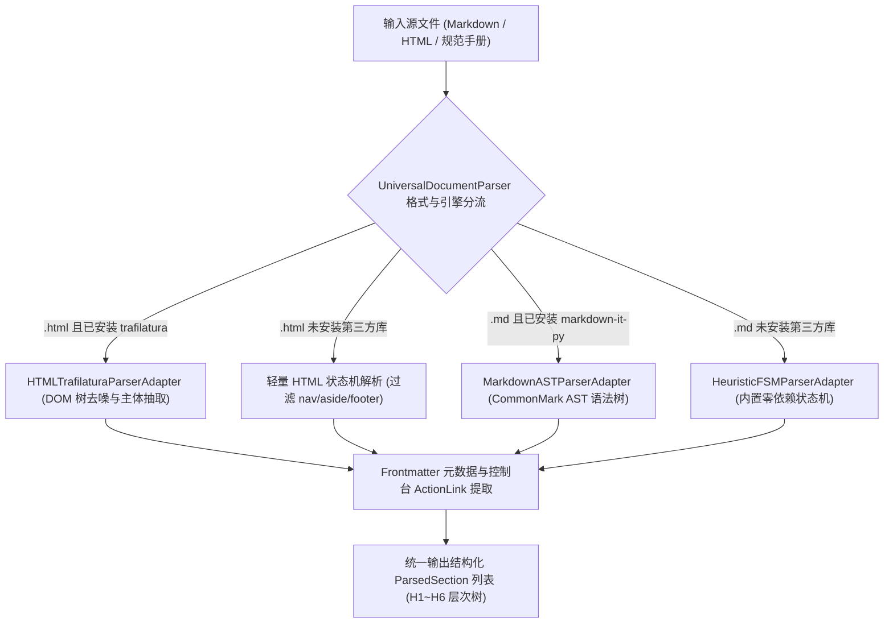
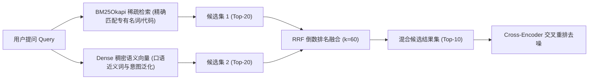

# 数据摄取与上下文检索深度实践 (Ingestion & Contextual Retrieval)

## 一、 非标文档治理与结构化解析体系

高质量问答的前提是高质量的数据清洗与结构化提取。如果文档在解析阶段就被污染或丢失结构，后续的向量检索和模型推理都将沦为“垃圾进，垃圾出”。

本项目基于**适配器模式（Adapter Pattern）**构建了 `UniversalDocumentParser`，支持多引擎适配与优雅降级：



### 1. Markdown AST 语法树解析器 (`MarkdownASTParserAdapter`)
传统按正则表达式 `^#+\s` 匹配标题的方法存在严重缺陷：
- 代码块内部的注释（如 `# Python comment`）会被误判为 Markdown 标题；
- 嵌套表格、列表缩进和 Setext 下划线标题（`===` 或 `---`）会破坏分块；
- 标题可能丢失与正文源码行的对应映射。

`MarkdownASTParserAdapter`（代码位于 `examples/knowledge_qa_agent/src/ingestion/parser.py:67`）使用 `markdown-it-py` 解析 CommonMark 语法树。通过遍历 `heading_open` Token 及其绑定的源码行区间（`token.map`），精准获取章节起止行，完整保留原生 Markdown 内容（包括表格与代码块），杜绝误切。

### 2. HTML 网页正文去噪解析器 (`HTMLTrafilaturaParserAdapter`)
当接入官方帮助中心或生产控制台导出的 HTML 页面时，页面中通常充斥着全局导航栏（`<nav>`）、促销弹窗（`<aside>`）、推荐链接和备案版权（`<footer>`）。
- 去噪适配器基于 `trafilatura` 执行网页主体抽取，将正文与控制台操作路径抽取出来；
- 在无第三方库环境下，内置轻量 DOM 状态机，基于栈结构过滤掉非正文标签，防止广告词和版权号污染检索索引。

---

## 二、 Anthropic Contextual Retrieval 落地实践

### 1. 核心原理与解决的痛点
在传统的 RAG 切分方案中，一段长文被硬切为数百字片段。例如以下段落：
> “当其超过 150 uL/L 时，必须立即执行紧急停机，并向运维中心上报二级故障。”

脱离上下文单独看这一句话时，检索系统和大模型根本无法确定“其”指代的是主变压器还是互感器，也无法确定是总烃还是乙炔。这导致了业界通常面临的约 **50% 的检索召回失败**。

Anthropic 提出的 Contextual Retrieval 核心思想是：在每一个切片入库前，动态注入该片段在整篇文档中的全局归属路径与上下文前缀。

### 2. 上下文面包屑路径注入机制
在 `ContextualChunker`（代码位于 `examples/knowledge_qa_agent/src/ingestion/chunker.py:9`）中，系统维护动态层级栈，为每个子切片计算并注入 `contextual_prefix`：

```python
# 示例：动态构建的面包屑前缀
contextual_prefix = "[上下文路径: 变压器规程 > 5. 故障研判 > 5.1 三比值法注意值]"
# 最终用于建索的文本
contextualized_content = f"{contextual_prefix}\n{raw_content}"
```

实测表明，注入面包屑路径后：
- 精确参数与错误码的字面检索召回率大幅提升；
- 向量模型能够有效区分同名章节在不同父级系统下的语义差异（例如“云网关安全策略”vs“边缘主机安全策略”）。

---

## 三、 Small-to-Big 父子切片与表格原子性保护

很多技术文档的核心内容是**数据表格**与**操作步骤列表**。按固定字符大小硬切往往直接截断表格，导致大模型仅能看到表格后半段的数值，丢失表头定义。

### 1. 表格原子性切分策略
`ContextualChunker` 实现了 `_split_paragraphs_preserving_tables`：
- 在扫描 Markdown 段落时，利用正则状态机检测表格行（`| col1 | col2 |`）；
- 表格被标记为**不可分割原子单元（Atomic Unit）**，优先完整保留在单一子块中；
- 仅当单张表格字数超过上限时，才执行按行切分，且切分后的每个表格子块均**强行复制原始表头**。

### 2. Small-to-Big 父子块索引机制
系统在切片时同时生成两类 Chunk：
- **细粒度子块（Child Chunks）**：字数通常在 200~350 字符之间，注入了面包屑路径，专供 BM25 和向量数据库进行高精准度召回；
- **粗粒度父块（Parent Chunks）**：保存整个章节或完整表格的全部内容（数千字），每个父块拥有唯一的 `chunk_id`。

子块通过 `parent_id` 显式关联其父块。在最终组装大模型 Prompt 时，系统顺着命中子块的 `parent_id` 还原完整父块，使大模型获得充足的上下文，彻底解决长表格和跨句指代割裂问题。

---

## 四、 混合检索与 RRF (Reciprocal Rank Fusion) 融合

单纯依赖向量检索极易产生“语义漂移”，对精确错误码（如 `ERR_GATEWAY_502`）召回乏力；而单纯依赖关键词匹配又无法理解同义口语表达（如“同源策略报错”）。

本项目在 `src/retrieval/` 下实现了生产级双路混合检索：



### 1. BM25 Okapi 稀疏检索实现细节
代码位于 `examples/knowledge_qa_agent/src/retrieval/bm25.py:10`：
- **复合分词器**：提取英文标识符、技术错误码与短横线拆分（将 `err_gateway_502` 分解为 `err`、`gateway`、`502`）；对中文字符串生成 2-gram 窗口及 3~4 字词块；
- **BM25 参数调优**：选取 $k_1 = 1.5, b = 0.75$，计算文档长度归一化 IDF 分数。

### 2. Dense 稠密语义向量检索
代码位于 `examples/knowledge_qa_agent/src/retrieval/dense.py:12`：
- 生产环境加载 fastembed ONNX 运行时与智源开源模型 `BAAI/bge-small-zh-v1.5`（512 维向量）；
- 无依赖环境下平滑回退至内置轻量语义空间模拟器，计算余弦相似度（Cosine Similarity）。

### 3. RRF 倒数排名融合数学原理
BM25 的绝对得分与向量余弦相似度的打分尺度截然不同，直接按权重线性加权（如 $0.5 \times BM25 + 0.5 \times Dense$）极易受异常极大值扭曲。

RRF（Reciprocal Rank Fusion，代码位于 `examples/knowledge_qa_agent/src/retrieval/hybrid.py:10`）只依据候选片段在各自列表中的相对排名计算融合分：
\[
RRF\_Score(d) = \sum_{m \in \{BM25, Dense\}} \frac{1}{k + rank_m(d)}
\]
其中常数 $k$ 设置为 60（业界公认标准参数），能够平滑极高名次的影响，兼顾两路检索的召回优势。

---

## 五、 Cross-Encoder 交叉重排去噪

双路初筛召回的 Top-20 结果中往往夹杂着仅命中部分词汇但整体语义无关的噪声片段。如果不加筛选直接送入上下文，不仅浪费 Token，还会分散大模型的注意力。

`CrossEncoderReranker`（代码位于 `examples/knowledge_qa_agent/src/retrieval/reranker.py:10`）对初筛候选集进行 Query-Doc 交叉注意力打分：

1. **词面精准重合度计算**：计算 Query 中的有效 Token 在正文及元数据中的重叠率（权重 45%）；
2. **结构化上下文分类奖励**：若 Query 关键词命中切片的面包屑路径或章节标题，给予 0.2~0.4 的置信度加成；
3. **领域核心参数与实体加权**：识别特定故障码（如 `502`, `waf`）或垂直行业特征气体（如 `c2h2`, `总烃`, `三比值法`），若双方同时出现给予 0.3 的奖励；
4. **硬阈值截断（Threshold Gating）**：重排归一化得分低于设定阈值（如 0.25）的候选切片直接被阻断过滤，绝不流入下游生成环节。
