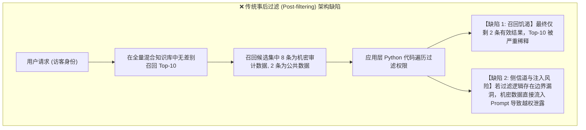
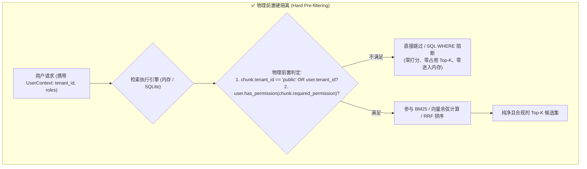

# 企业级多租户与 RBAC 物理硬隔离架构 (Multitenancy & RBAC Security)

## 一、 为什么必须采用“前置物理硬隔离”？

在面向企业集团、政企金融或多部门共享的复杂系统知识库中，不同用户拥有不同的数据边界。例如：
- 外部普通租户或访客（Guest）仅可查阅公共产品手册与公开规程；
- 集团合规审计员（Auditor）可查阅内部敏感的报销审批、财务凭证及审计通报；
- 生产调度专责（Dispatcher）可查阅高压变压器实时测点与带电检修规程。

### 传统“事后过滤（Post-filtering）”的致命缺陷
早期许多 RAG 系统采用“先检索召回 Top-20，再在内存中遍历过滤”的事后方案：



事后过滤存在三大本质隐患：
1. **召回饥渴与指标失真**：Top-K 候选集被大量高相关但无权限的私有切片占据，过滤后返回的有效片段寥寥无几，严重损害检索召回率。
2. **算力与 Token 浪费**：为最终被丢弃的未授权切片执行了高昂的向量打分与 Cross-Encoder 重排。
3. **数据泄露风险**：一旦应用层代码出现逻辑漏洞或异常捕获失效，未授权敏感切片直接送入大模型 Prompt，存在被越狱抽取的合规风险。

---

## 二、 物理前置硬过滤 (Hard Pre-filtering) 机制

本项目坚持**物理前置硬过滤**原则：在数据检索计算发生的**最底层（内存索引遍历或磁盘 SQL 查询）**即刻实施隔离断言，未授权数据根本不参与任何相似度打分或排序。



### 1. 内存检索前置过滤实现
在 `BM25Retriever.search()`（`examples/knowledge_qa_agent/src/retrieval/bm25.py:112`）与 `DenseSemanticRetriever.search()`（`examples/knowledge_qa_agent/src/retrieval/dense.py:90`）中：
```python
# 多租户与 RBAC 前置过滤
if user_context is not None:
    # 租户隔离断言：非公共切片必须与当前用户租户严格一致
    if chunk.tenant_id != "public" and chunk.tenant_id != user_context.tenant_id:
        continue
    # 细粒度权限断言：必须具备切片要求的最小角色/权限
    if not user_context.has_permission(chunk.required_permission):
        continue
```
未授权切片被立即跳过，绝不占用 Top-K 候选席位，彻底解决了召回饥渴。

### 2. 用户上下文与权限契约 (`UserContext`)
定义于 `examples/knowledge_qa_agent/src/models.py:31`：
- 支持租户标识 `tenant_id`；
- 支持角色继承与通配符提权（如 `*:*`、`Admin`、`Security:Admin` 具备所属域完全访问权）；
- 默认公共切片对所有合法用户开放。

---

## 三、 本地嵌入式持久化安全存储 (`SQLiteLocalStore`)

为保障系统在离线私有化环境或轻量化边缘节点的安全运行，系统构建了基于 SQLite 的嵌入式持久化存储（代码位于 `examples/knowledge_qa_agent/src/storage/sqlite_store.py`）：

### 1. 表结构与索引设计
```sql
CREATE TABLE IF NOT EXISTS chunks (
    chunk_id TEXT PRIMARY KEY,
    doc_id TEXT,
    title TEXT,
    breadcrumbs_json TEXT,
    raw_content TEXT,
    contextual_prefix TEXT,
    parent_id TEXT,
    is_parent INTEGER,
    console_path TEXT,
    cli_command TEXT,
    required_permission TEXT,
    tenant_id TEXT DEFAULT 'public',
    embedding_blob BLOB,
    metadata_json TEXT
);

CREATE INDEX IF NOT EXISTS idx_chunks_tenant_perm ON chunks(tenant_id, required_permission);
```

### 2. 原生 FTS5 全文倒排索引与 SQL 级前置阻断
系统集成了 SQLite 原生 FTS5 虚拟表，并在执行全文检索时通过 SQL 关联进行物理过滤：
```sql
SELECT c.*, fts.rank
FROM chunks_fts fts
JOIN chunks c ON fts.chunk_id = c.chunk_id
WHERE chunks_fts MATCH ?
  AND (c.tenant_id = 'public' OR c.tenant_id = :tenant_id)
ORDER BY fts.rank
LIMIT :top_k;
```
由于过滤条件直接位于 SQL 引擎查询计划内部，从根本上确保了磁盘数据读取时的租户硬隔离。

### 3. 向量 BLOB 序列化与冷启动
向量浮点数组通过 Python `struct.pack(f"{dim}f", *emb)` 序列化为轻量二进制 BLOB 写入数据库。应用进程重启时，可在数百毫秒内从单文件 `knowledge_base.db` 完成冷启动恢复，无需额外依赖任何外部大型向量数据库服务。
