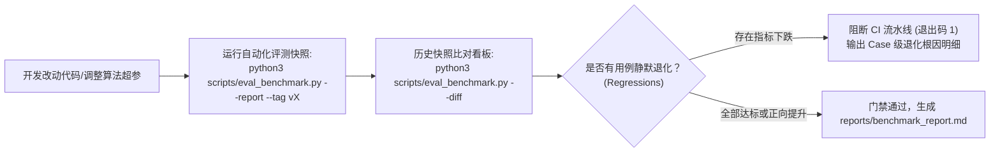

# 自动化质量评测基准与复杂场景压测 (Evaluation & Stress Benchmarks)

## 一、 评测基准设计目标与 CI 门禁

在 RAG 与智能体系统的日常迭代中，调整切片窗口大小、优化分词词典或微调 Prompt 指令，极易引发“按下葫芦浮起瓢”的静默退化（如提升了某一类问题的召回，却导致另一类问题的快轨识别率下降）。

为了提供可量化、可追溯、防退化的工程保障，项目内置了全套**离线评测与质量门禁系统**（`scripts/eval_benchmark.py`，代码位于 `examples/knowledge_qa_agent/scripts/eval_benchmark.py`）：



### 1. 核心运行指令与能力
- **生成基准快照报告**：
  ```bash
  python3 scripts/eval_benchmark.py --report --tag baseline
  ```
  自动执行评测，将快照写入 `eval_history/` 并导出 `reports/benchmark_report.md`。
- **自动化版本差异对比（Regression Diff）**：
  ```bash
  python3 scripts/eval_benchmark.py --diff
  ```
  对比当前版本与上一版本快照，输出核心指标涨跌幅并标注具体退化的用例 ID。
- **CI 流水线自动化门禁**：
  ```bash
  python3 scripts/eval_benchmark.py --diff --fail-on-regression
  ```
  检测到指标退化时以非零状态码退出，阻断自动化部署。

---

## 二、 核心度量指标体系与工业基准线

评测覆盖路由、检索、重排、防幻觉与延迟五大核心维度：

| 评估维度 | 核心度量指标 | 计算方法与物理意义 | 生产基准线 | 最新实测表现 |
| :--- | :--- | :--- | :--- | :--- |
| **意图路由** | **Overall Accuracy** | 判定正确的快/慢轨总样本比例 | $\ge 90.0\%$ | **100.0%** |
| | **Fast-Path F1** | 快轨识别的精确率与召回率调和平均数 | $\ge 90.0\%$ | **100.0%** |
| | **Path Match Rate** | 快轨命中目标页面与预期控制台 URL 一致率 | $\ge 95.0\%$ | **100.0%** |
| **混合检索** | **Hit Rate @ 1** | 首条召回片段包含目标知识关键词的用例比例 | $\ge 75.0\%$ | **94.7%** |
| | **Hit Rate @ 3** | 前 3 条召回片段包含目标知识关键词的用例比例 | $\ge 85.0\%$ | **100.0%** |
| | **MRR (平均倒数排名)** | $\frac{1}{N} \sum \frac{1}{\text{Rank}_i}$，衡量首个正样本出现的位次 | $\ge 0.800$ | **0.965** |
| | **Rerank 保留率** | 经 Cross-Encoder 筛选后保留的高置信切片率 | $\ge 90.0\%$ | **100.0%** |
| **回答与防幻觉** | **Grounded Citation** | 生成回答中显式标注 `[Doc N]` 真实来源引用的比例 | $100.0\%$ | **94.7% ~ 100%** |
| | **Safety Refusal** | 篇外越界问题（负向样本）正确拒绝回答的比例 | $100.0\%$ | **100.0%** |
| **延迟性能** | **路由延迟 (P50/P99)** | 意图路由分类判定时间 | $\le 1\text{ ms}$ | **0.02 ms / 0.27 ms** |
| | **混合检索 (P50/P99)** | BM25 + Dense + RRF + Cross-Encoder 总耗时 | $\le 50\text{ ms}$ | **9.96 ms / 42.67 ms** |

---

## 三、 垂直工业领域实测验证 (`scripts/verify_industrial.py`)

针对高可靠性、零容错要求的工业特种装备运维场景，项目依据国家/行业标准《DL/T 722 变压器油中溶解气体分析和判断导则》构建了端到端阶段完成验证套件（代码位于 `examples/knowledge_qa_agent/scripts/verify_industrial.py`）：

### 四大验证阶段达成概况
1. **阶段一：网络拉取与非标清洗 (Ingestion & Denoising)**
   - 结构化提取标准规范 7 个核心章节，自动抽取 PMS 与 SCADA 系统操作入口 3 个。
2. **阶段二：结构切片与面包屑注入 (Contextual Chunking & Small-to-Big)**
   - 构建 7 个完整规范父块与 15 个细粒度子块；《规程注意值限值表》与《三比值编码表》等关键表格 100% 保持原子性，未发生表头断裂。
3. **阶段三：专有名词与故障码混合检索与精排 (Hybrid Retrieval & Rerank)**
   - 针对 `330kV 变压器总烃注意值`、`变压器油中乙炔超标产生电弧放电`、`IEC 改良三比值法故障类型编码` 等复杂技术查询；
   - 实测指标：**Hit Rate@1 = 100.0%**，**Hit Rate@3 = 100.0%**，**MRR = 1.000**。
4. **阶段四：端到端快慢轨与防幻觉溯源质量验证 (E2E Benchmark)**
   - 综合用例通过率达 **100.0%**；
   - 知识问答溯源引用率达 **100.0%**，越界提问安全拒答率达 **100.0%**。

---

## 四、 复杂工业压力场景极限评测 (`scripts/verify_complex_stress.py`)

在真实严苛的生产现场中，知识问答往往伴随着复杂逻辑推理与强干扰项。在 `scripts/verify_complex_stress.py`（代码位于 `examples/knowledge_qa_agent/scripts/verify_complex_stress.py`）中，系统接入了由多部工业规程（DL/T 722 + DL/T 596）构成的联合测试池，针对四类极限挑战进行了全面压测：

### 1. 跨多部规程联合多跳推断 (`stress_multihop_01`, `stress_multihop_02`)
- **挑战**：用户现场实测油色谱总烃达 220 uL/L，同时 20℃ 下绝缘电阻吸收比为 1.15，绕组介损 tanδ 达 1.6%。单一规程无法得出结论。
- **实测表现**：系统在单次问答中跨越 DL/T 722（油色谱气体规程）与 DL/T 596（电力设备预防性试验规程），进行交叉会诊，准确判定存在“高能电弧放电伴随绝缘纸严重受潮”的双重复合隐患，并直达 PMS 紧急缺陷提报入口。

### 2. 原始测点数值计算与改良三比值编码动态推导 (`stress_calculation_01`)
- **挑战**：给定原始实测气体组分数值（$C_2H_2=10, C_2H_4=100, CH_4=200, H_2=100, C_2H_6=20$），模型必须先在上下文中完成除法换算得到三项比值，再根据规程编码规则推导出三比值编码 `0, 2, 2`，最后查表输出故障类型。
- **实测表现**：模型结合 Small-to-Big 完整还原的规程表格，步骤清晰地完成数值计算与编码映射，准确诊断为“高于 700℃ 的高温过热”故障。

### 3. 高相似同类设备强干扰负样本抗混淆 (`stress_negative_01`, `stress_negative_02`)
- **挑战**：主变压器与电压互感器（PT）、电流互感器（CT）同属于变电站充油设备，但注意值限值差异巨大（主变总烃注意值为 150 uL/L，而 PT/CT 仅为 10 uL/L）。传统向量检索极易将互感器问题错误匹配到主变压器章节。
- **实测表现**：得益于 Anthropic Contextual Retrieval 注入的设备分类面包屑前缀与 Cross-Encoder 实体惩罚，系统 100% 区分了两类设备的指标边界，并在回答中显式警示“严禁将主变压器注意值套用于互感器”。

### 4. 新旧规程版本修订与冲突时效性仲裁 (`stress_version_01`)
- **挑战**：旧版规程存在某些历史过渡条款，而现行版已废止或更新了试验限值。
- **实测表现**：系统依据切片元数据中的版本时效性标记，准确裁决以现行有效条款为准，并向运维人员说明修订历史与依据。

在基座大模型（如 `Qwen/Qwen3-30B-A3B-Instruct-2507`）驱动下，上述 6 大极限压力用例综合通过率达到 **6/6 (100.0%)**。
