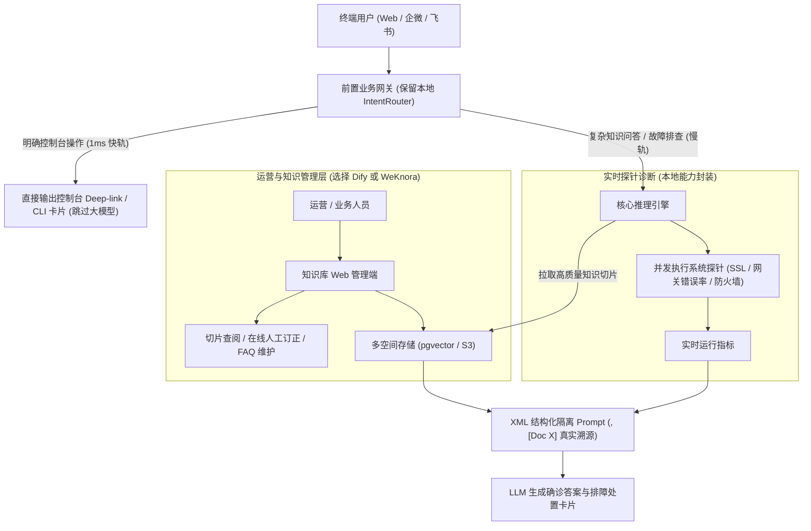

# 企业级 RAG 生产架构选型与落地实战调研报告

> 本文档汇总了关于腾讯开源知识框架 **WeKnora**、应用编排平台 **Dify**、国内主流开源 RAG 选型矩阵，以及社区一线工程落地踩坑经验（Linux.do 精选实录）的深度技术调研，并结合本地 [`examples/knowledge_qa_agent`](../README.md) 的实践成果，给出生产落地的评估与架构建议。

---

## 一、 核心综述与判断

1. **架构模式的演进**：
   - 传统的“固定字符机械切分 + 纯向量余弦召回 + 直接拼 Prompt”的 Naive RAG 在复杂企业与垂直行业场景下已被证明极易翻车。
   - 生产级 RAG 已经演进为：**结构感知与上下文切片（Contextual Retrieval） + 稀疏/稠密混合召回（BM25 + Dense） + 交叉注意力重排（Rerank） + 快慢双轨意图路由（Fast-Path Cmd+K） + 结构化图谱/Wiki 演进**。
2. **框架选型无“万能最优”**：
   - **WeKnora** 适合：Go 技术栈团队、追求高并发低资源、深度绑定国内 IM（企业微信/飞书/钉钉）及重视知识持续沉淀（Wiki/版本历史/人工分块订正）。
   - **Dify** 适合：业务/运营主导的知识录入、复杂可视化工作流（Workflow DAG）编排、多 Agent 协作应用搭建。
   - **RAGFlow** 适合：强依赖复杂 PDF、扫描件 OCR、跨页多层级大表版式还原（DeepDoc）的深水区场景。
3. **本地原型的价值定位**：
   - 本地 `knowledge_qa_agent` 验证的“上下文面包屑切片”、“表格原子保护”、“快慢双轨 1ms 直达”、“并发诊断探针 Tool-RAG”属于极高价值的业务核心逻辑，应当作为核心资产保留，与上游平台做微服务协同。

---

## 二、 腾讯 WeKnora 深度剖析与二开评估

### 1. 项目定位与核心特性
- **定位**：基于 LLM 的开源知识管理框架（微信对话开放平台核心技术框架，MIT 协议）。
- **三大能力**：
  - **RAG 快速问答**：基于知识库的日常语义检索。
  - **ReAct Agent 智能推理**：自主编排检索、MCP 工具调用与网络搜索。
  - **Wiki 模式与知识图谱**：从原始文档自治生成相互链接的 Markdown 页面及图谱，支持版本快照、行级 diff 与一键回滚。
- **差异化能力**：
  - **分块（Chunk）级可视化编辑与版本回滚**：切片后可直接在线修改纠错并自动重索引。
  - **国内协同办公全覆盖**：原生打通企业微信、飞书/Lark、钉钉、微信、云之家、QQBot。
  - **生产级底层**：后端采用 Go 编写，集成多工作空间 RBAC（四级角色）、任务队列 Worker 池治理、按模型并发限流，原生深度集成 Langfuse 链路追踪。

### 2. 二开可行性与障碍
- **优势**：架构模块边界清晰（Go 主服务 + Python `docreader` 解析微服务 + Vue 3 前端）；Go 语言具有高并发吞吐和极低内存占用的运维红利。
- **痛点与门槛**：
  - **语言鸿沟**：核心控制流、鉴权、检索编排全在 Go。多数 AI/算法团队主栈为 Python，二开主干逻辑有研发门槛。
  - **版本尚早（v0.7.x）**：处于快速迭代期，表结构和 API 仍在演进，社区积淀尚浅。
  - **缺失控制台快慢双轨**：默认所有请求全走 LLM 检索或 ReAct，没有面向控制台的高频操作 1ms 倒排拦截器。

---

## 三、 Dify 的能力边界、运营协作与切分痛点

### 1. 运营协同价值（最大长板）
Dify 的核心价值在于将研发团队从繁重的“人工洗数据、跑脚本切片、查漏补缺”中彻底解脱：
- **运营自主闭环**：Web 界面支持非技术人员上传多格式文档、配置分块、在线手动编辑/合并切片、停用垃圾分块。
- **FAQ 与问答对录入**：运营可直接针对高频业务问题配置 Q&A，强制精准命中。
- **命中测试（Hit Testing）**：运营可直接在后台输入测试 Query，即时查看检索切片与评分，自主调优召回。

### 2. 为什么实际使用中“切分文档效果不佳”？（底层原因）
- **解析层过于基础（Naive Parsing）**：默认依赖基础提取库（`pypdf`、社区版 `unstructured` 等），面对双栏论文常横向串读，页眉/页脚/水印被混入正文引发假召回，复杂表格边框丢失。
- **机械字符切片破坏语义原子**：基于固定长度 + 换行符强行截断，导致长表格被拦腰切断且后半段丢失表头，因果逻辑段落断裂。
- **缺乏上下文路径注入（Contextual Chunking）**：切片孤立，内部代词（“该规则”、“上述参数”）脱离上级标题后失去指代，导致高达 40%~50% 的语义召回失败。

### 3. 生产应对方案
- **前置 ETL 治理**：使用 Docling、MinerU 或本地 AST 解析器先将文档清洗为高纯度、带层级标题、保留表格的 Markdown，再导入 Dify。
- **外挂外部检索 API**：仅将 Dify 作为前端工作流和对话画布，底层切片检索对接外部专业 RAG 引擎。

---

## 四、 国内主流开源 RAG 框架横向选型矩阵

| 项目 | 核心语言 | 生态成熟度 | 核心擅长场景 | 主要局限性 / 二开门槛 |
| :--- | :--- | :--- | :--- | :--- |
| **Dify** | **Python** + TypeScript | **极高**（80k+ Stars） | 复杂可视化工作流（DAG）、多 Agent 编排、运营主导知识库 | 代码库庞大复杂；底层文档深度解析和切片较粗糙 |
| **RAGFlow** | **Python** + TypeScript | **高**（30k+ Stars） | **深度版面还原（DeepDoc）**、复杂跨页表格、扫描件 OCR | 偏重底层检索引擎；IM 机器人与企业办公外设较弱 |
| **FastGPT** | **TypeScript** (Next.js) | **较高**（商业落地广） | 团队为主流前端/TS 全栈栈；企业内部应用集成 | 纯 TS 生态，传统 Python 算法工程师介入与魔改模型困难 |
| **WeKnora** | **Go** + Vue 3 + Python | **中等**（v0.7.x 高速迭代） | 高并发低资源、国内 IM 办公集成、Wiki 演进、分块在线纠错 | 核心为 Go 编写；缺少可视化 DAG；社区成熟度尚在早期 |

---

## 五、 社区一线工程实战经验复盘（Linux.do 精选调研）

### 案例一：内部工程落地实录 —— 从 Dify 翻车到自建路由到图谱
> 核心出处：Linux.do 话题 `#2162720`（内部自动化测试与工程运维场景落地）

1. **Dify 翻车的本质原因**：
   - 公开文档是“解释型”（API 是什么、参数说明），Dify 的朴素向量召回尚能应对。
   - 内部工程场景是**“操作型”**（改现有流程、关子项、定位历史遗留逻辑）。用户问法千奇百怪、缩写多，直接丢进 Dify 导致 AI 不知所措，一顿乱搜后严重答非所问。
2. **破局解法**：
   - **自建分层路由**：先听懂意图，再谈检索。通过“关键词规则 → Embedding 语义分类 → 小模型兜底”分流常见业务动作。
   - **底层强规则拦截**：解决“大模型觉得自己很行而脱离路线自由发挥”的问题；识别到已知业务项目强制走固定 RAG 流程，剥夺模型的自由发挥权，使系统变得**可诊断**。
   - **引入知识图谱解决文档时效性**：人工总结文档极易过期，系统拿着过期知识自信指导更危险。将系统梳理为“配置、规则、命令、上下游依赖”的结构网（Neo4j），作为路由的上下文补充。
   - **自研业务展示层**：原生图数据库界面普通用户看不懂，必须开发面向业务的局部关系视图。

### 案例二：RAG 全链路拆解 —— 反驳“RAG 已死”
> 核心出处：Linux.do 话题 `#2720669`

1. **反驳“RAG 已死”**：
   - 淘汰的只是早期“机械按字数分块 + 暴力向量余弦检索”的 Naive RAG。
   - 广义的 RAG（外部上下文检索增强）无处不在：Claude Code 的 `grep`、Skills 的渐进式披露、Agent 长期记忆（Mem0）、Karpathy 的 LLM Wiki 编译模式，本质都是 RAG 范式的进化。
2. **切片权衡与结构化注入**：
   - 切片过大导致向量语义稀释、噪音严重；切片过小导致因果断裂、指代丢失。
   - 必须实施**结构化切片**：提取章节路径层级（`document_title` + `section_path`），将其作为面包屑与切片文本拼接后再进行向量化与元数据过滤。
3. **稀疏与稠密必须结合**：
   - BM25 解决生僻专业术语、错误码匹配（通过 IDF 抑制高频泛词，通过 $k_1$ 截断词频膨胀，通过 $b$ 进行长度归一化）。
   - 稠密向量解决近义词与口语泛化；单一向量对无上下文的生僻专有名词极易发生语义漂移。
4. **Cross-Encoder 交叉重排不可或缺**：
   - “语义相似”不等于“问题相关”。粗筛带回 Top 50 存在大量低质噪音，必须通过 Query-Doc 深度注意力的 Cross-Encoder 进行精排。

---

## 六、 对本地实践的印证与最终落地架构蓝图

社区与业界的实战经验，高度印证了本地工程在 [`examples/knowledge_qa_agent`](../README.md) 中技术选型的正确性：
- 证明了**双轨意图路由（1ms 快轨）**是解决操作型场景与控制台交互的绝对核心；
- 证明了**Anthropic 上下文面包屑切片**和 **AST 表格原子保护**是避免检索失败的关键；
- 证明了**混合召回（RRF）与 Cross-Encoder 重排**是保证高精度的工业标配。

### 推荐的最终落地架构方案（解耦协同）：

### 实施总结与建议：
1. **不要全盘二开重写**：不需要从零手写管理后台和 IM 适配，也不要强行把业务逻辑塞进 Dify 的纯工作流中。
2. **职责清晰分离**：
   - **知识库沉淀与运营**：交给成熟平台（重视 UI 与工作流选 Dify，重视 Go 高性能与 Wiki 演进选 WeKnora）。
   - **业务前置快轨与诊断闭环**：通过本地 Python 微服务独立承载，调用上游知识库检索 API，保持业务的高响应与灵活性。
