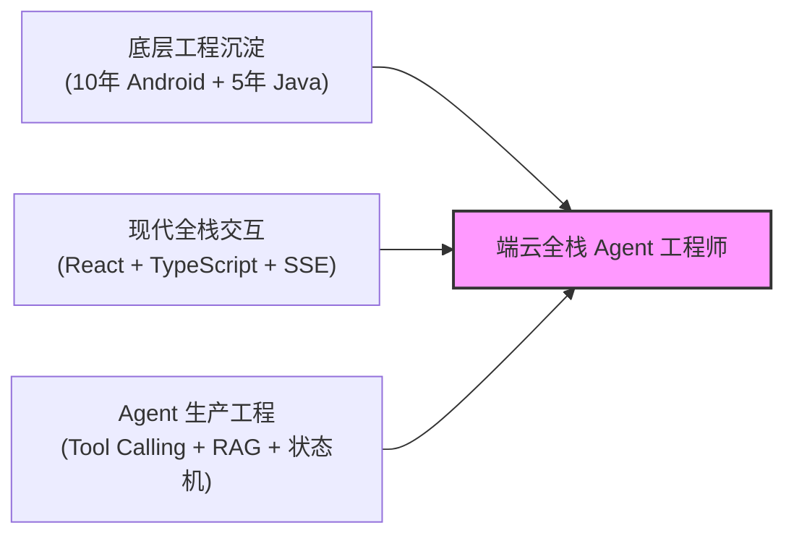

# 10 年客户端经历的资产转化叙事：从客户端专家到端云全栈 Agent 架构师

## 一、核心定调与叙事原则

### 1. 根本立场：不是“被迫转行”，而是“工程能力的向上延伸与业务闭环”
- **自杀式表述（坚决避免）**：
  - “移动端行业不景气，HC 变少了，所以我想转全栈/AI 看机会。”
  - “我虽然做客户端 10 年，但我对前端和 Python 很感兴趣，愿意从头学起。”
- **高阶架构师表述（必须贯彻）**：
  - “在过去 10 年中，我深入完成了客户端高可用架构、长连接协议、复杂状态机以及 Java 服务端的全流程交付。当前大模型时代的业务痛点，恰恰是‘AI 原型很多，但具备复杂状态管理、长连接流式交互、高可靠容错和端云协同能力的端到端工程闭环极少’。我的技术栈演进，是将客户端的极致体验与稳定性经验，向上延伸为能够独立交付 Web 全栈并让 Agent 在严肃业务中稳定运行的应用工程能力。”

### 2. 核心竞争力三元组

1. **复杂状态治理能力**：客户端工程师对页面生命周期、事件单向数据流（MVI/Redux）、多线程竞态的敏感度，远超普通纯脚本 CRUD 工程师，这是驾驭 LangGraph/Agent 多轮复杂状态的降维武器；
2. **流式与长连接排障经验**：SSE/WebSocket 长连接保活、弱网断线重连、数据包序号对齐与自适应渲染，本身就是客户端通信架构的核心基本功；
3. **系统可靠性与防御性编程**：从 Crash 率治理、ANR 排查、内存泄漏治理（LeakCanary/MAT），自然迁移至大模型系统的超时重试、幂等防重、降级熔断与全链路 Tracing。

---

## 二、自我介绍 2 分钟黄金逐字稿

### 版本 A：面试目标为【高级全栈工程师 / 业务应用负责人】
> “您好，我叫 [姓名]，拥有约 10 年移动客户端与 5 年 Java 企业级后端的工程交付经验，近两年深度聚焦于现代 Web 全栈与 AI Agent 的业务落地。
> 
> 在我的技术底座中，Java 赋予了我对高并发并发模型、JVM 性能调优、事务一致性与分布式稳定性的系统级掌控力；而 10 年的客户端经历，让我对跨端通信、复杂 UI 状态机、长连接流式渲染以及系统容灾治理具备了严苛的工程标准。
> 
> 针对当前业务系统对 AI 能力的迫切需求，我主导设计了**企业知识与业务研究助手**全栈平台：后端使用 Spring Boot 承接用户权限、审计流水与业务控制面，数据层基于 PostgreSQL + pgvector 实现了单库 ACID 下的混合向量检索与行级租户隔离；AI 运行时基于 Python FastAPI 实现了原生 ReAct 循环、两阶段人工审批挂起与断点续传；前端采用 React + TypeScript，通过自研缓冲队列解决了高频 SSE 流式打字机的渲染掉帧与状态闭包陷阱。
> 
> 我最大的特质是**具备端到端的架构视野与单兵复杂系统交付能力**。我不只关注功能跑通，更注重系统在网络抖动、模型超时、权限穿透等极端异常下的健壮性。期待在今天的沟通中与您深入交流。”

### 版本 B：面试目标为【AI / Agent 应用工程师】
> “您好，我叫 [姓名]，具有 10 年客户端系统架构与 5 年 Java 服务端经验，目前专注于将自主 Agent 深度融入企业真实业务工作流。
> 
> 业内许多 AI 项目停留在简单调用 API 或做纯聊天 Demo 的阶段，一旦面临企业级交付，就会在‘工具调用不可控、长耗时任务中断、提示词注入越权、缺乏评测体系’上遇到瓶颈。而这些痛点在底层逻辑上，正是复杂分布式系统与客户端长期解决的状态一致性、弱网长连接保活与系统安全问题。
> 
> 在我的实践中，我深入构建了一套完整的 Agent 应用工程闭环：
> 1. **在执行可靠性上**：建立了工具调用的四级错误治理体系，为写操作注入全局幂等键防范重复副作用，并基于 Checkpoint 实现了高危操作的人工审批中断与无状态恢复；
> 2. **在检索质量上**：基于 pgvector 落地了 BM25 与向量双路召回及 Cross-Encoder 重排流水线，通过 Small-to-Big 架构解决大段落语义丢失问题；
> 3. **在可观测与评测上**：集成了全链路 Tracing，搭建了覆盖答案忠实度、工具选对率与端到端任务完成率的自动化回归评测集。
> 
> 凭借深厚的客户端与后端底层内功，我能够高效串联前端交互、企业业务网关与模型运行时，交付稳定、安全且经得起高并发考验的生产级 Agent。非常荣幸参与今天的面试。”

---

## 三、四大核心能力资产映射矩阵

在面试官深挖技术细节时，运用下表进行“降维映射”，将客户端经验转化为面试优势：

| 客户端（Android）深度经验 | 底层共性机制 | 全栈 / Agent 生产场景映射 | 面试口述切入点 |
| :--- | :--- | :--- | :--- |
| **Activity/Fragment 复杂生命周期、MVI 单向数据流、StateFlow** | 状态机驱动、状态不可变性、挂起与恢复 | **LangGraph / Agent 状态机持久化、Human-in-the-loop 人工审批中断** | “我在客户端处理过大量的页面销毁重建与状态保存，这与 Agent 执行高危工具时基于 Checkpoint 挂起上下文、等待审批后再恢复状态机的原理完全一致，核心都在于状态快照的幂等恢复。” |
| **TCP/WebSocket 长连接保活、心跳机制、弱网断网重连** | 传输层可靠性、事件序列号对齐、网络容灾 | **SSE 流式传输、`Last-Event-ID` 断点补发、网关超时代理** | “流式生成不是前端单向打字机。我把客户端处理长连接断线重连的思路引入到 Web：后台异步任务持久化事件流，客户端断线携带 Last-Event-ID 触发服务端缓存补发，保障大模型长时间推理的传输稳定性。” |
| **Android UI 渲染管线、Choreographer 16ms 垂直同步、列表复用** | 帧率优化、批量缓冲、DOM 树 Diff 消耗控制 | **React 高频流式 Markdown 渲染优化、虚拟滚动视口动态测量** | “大模型每秒吐几十个 token 会直接打崩 React 协调引擎。我在前端引入了类似 Android 渲染的 `requestAnimationFrame` 批处理缓冲与局部叶子节点渲染，将高频刷新限制在局部组件，保证页面 60 FPS。” |
| **Crash 治理、LeakCanary 内存泄漏排障、ANR 治理** | 资源泄漏定位、支配树分析、I/O 阻塞主线程防范 | **JVM 排障（OOM/CPU 100%）、异步 I/O 防线程池耗尽、LLM 网关背压** | “我在客户端常年做内存支配树排查和线程死锁治理。在后端与 AI 网关中，面对 LLM 长耗时阻塞，我严格推行非阻塞异步编程与线程池背压机制，从根本上防止连接池与工作线程耗尽。” |

---

## 四、高频刁难追问与现场反击策略

### Q1：“你做客户端这么多年，为什么现在看全栈和 Agent？是不是因为移动端没 HC 了？”
- **防守逻辑**：承认技术浪潮的客观迁移，但将重心转向自身技术的“水到渠成”与“业务痛点”。
- **参考回答**：
  > “移动端红利见顶、增量减少是行业客观现状，但我选择向全栈和 Agent 演进，本质是**工程师对交付完整业务价值的追求**。
  > 过去做客户端，很多时候受限于只能交付端侧局部体验，依赖后端定义好的接口。而在当前 AI 浪潮下，最有价值的岗位是‘能够把模型能力打穿到真实业务系统、完成端到端闭环的人’。
  > 我有 5 年 Java 底层积累，补充现代 Web 全栈和 Python Agent 体系后，我能够一个人拉通从前端流式交互、后端权限事务、到 AI 运行时编排的全链路。这种全栈交付视角，比单一客户端或单一脚本后端工程师能创造更大的全局价值。”

---

### Q2：“你的 Python 和 React 实际商业经验不如专门做前端/算法的同学，我们为什么要给你高级岗位？”
- **防守逻辑**：将语言/框架定义为“语法工具”，高级工程师的核心壁垒是“系统架构、异常防线与复杂问题定位”。
- **参考回答**：
  > “对于工作 10 年的工程师而言，语言语法和前端框架只是工具层面的实现细节。React 核心是组件生命周期、单向数据流与闭包，这与现代客户端架构完全同构；Python 核心是异步并发模型与面向对象设计。我可以在极短时间内掌握并规范化编写代码。
  > 高级工程师真正的溢价在于：
  > 1. **当系统面对高并发、网络抖动、内存泄漏时，谁能快速定位根因并止血**；
  > 2. **当模型返回格式错误、网络超时或并发限流时，谁能设计出完备的重试、幂等与安全沙箱**；
  > 3. **谁能对架构的长期可维护性、数据库事务一致性负责**。
  > 纯脚本开发者容易把系统写成跑通就行的脚本玩具，而我的系统级工程底蕴能确保把 Agent 做成高可用、可运维的企业级服务。”

---

### Q3：“很多团队认为 Agent 核心是写 Prompt 或微调模型，为什么需要强调全栈工程化？”
- **防守逻辑**：直击痛点——Prompt 调优门槛极低，系统的真正护城河在工程架构。
- **参考回答**：
  > “Prompt 决定了系统的效果上限，但**工程架构决定了系统的可用性下限**。
  > 在真实生产中，Prompt 调优往往占工作量的 20%，而剩下 80% 的工作是在解决：
  > - 如何处理上游 API 的 429 限流与 Token 成本控制？
  > - 如何防止具有写副作用的外部工具被重复执行导致资损？
  > - 如何隔离多租户数据，防止通过 Prompt 注入发生越权检索？
  > - 如何建立离线量化评测集，证明系统升级后指标确实提升了而不是主观感觉？
  > 这些全部是严肃的软件工程与系统设计命题。没有坚固的全栈工程底座，任何精妙的 Prompt 在企业并发冲击下都是脆弱的。”

---

## 五、简历项目措辞打磨规范（Bad vs Good）

在撰写简历项目与面试表述时，参照以下标准进行转换：

| 模块 | 弱化/平庸表述（Bad Case） | 资产化/高级架构表述（Good Case） |
| :--- | :--- | :--- |
| **客户端经验** | “负责 Android App 模块开发，完成 UI 绘制、网络请求封装与版本迭代。” | “负责核心客户端架构演进，设计基于 MVI 的单向状态机管道；主导长连接断线重连与弱网保活协议，使弱网连接成功率提升至 99.2%；建立 APM 监控与内存支配树分析体系，将 Crash 率压降至 0.03%。” |
| **全栈开发** | “使用 React 实现了聊天界面，用 Spring Boot 编写了用户登录和文档上传接口。” | “主导前后端全栈闭环架构：基于 Spring Boot 构建企业级控制面，落地基于 RBAC 的跨端权限与审计流水；前端基于 React + TypeScript 实现自适应流式打字机渲染管线，通过帧率缓冲彻底消除高频 SSE 协调掉帧。” |
| **Agent 工程** | “调用 OpenAI 接口实现了多轮对话与 RAG，使用 LangChain 集成了工具调用。” | “设计基于 ReAct 循环的生产级 Agent 运行时：构建工具调用四级容错机制与全局幂等键防重防线；落地基于 pgvector 的混合检索与 Cross-Encoder 重排流水线；设计两阶段 Checkpoint 持久化状态机，实现高危操作的人工审批阻断与无损唤醒。” |
