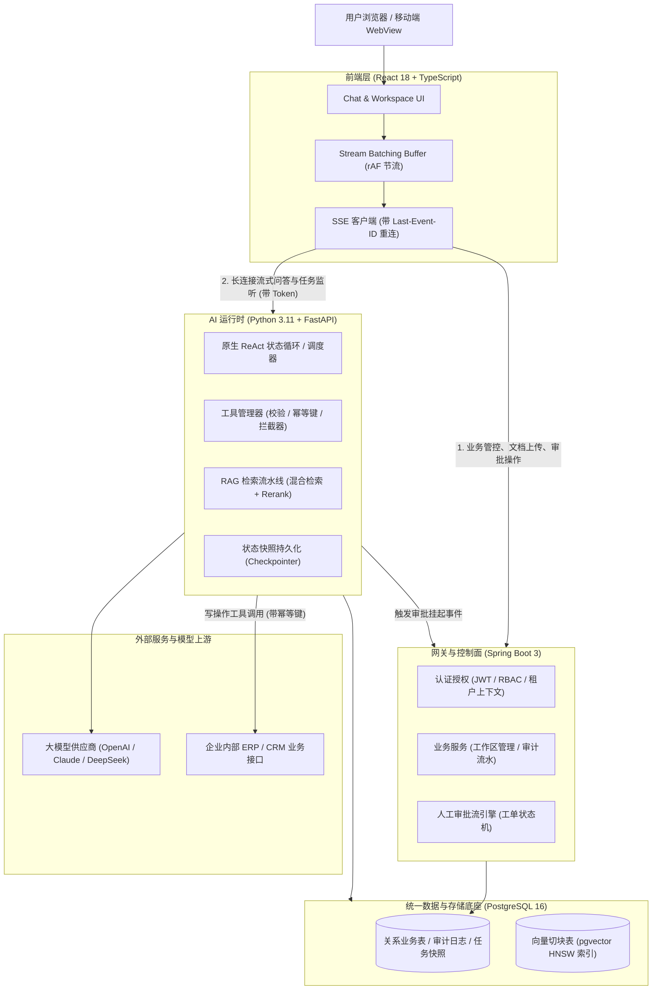

# 项目复盘：企业知识与业务研究助手（全栈 + Agent 架构）

## 一、项目全景与业务目标（Context & Business Goal）

### 1. 业务痛点与项目定位
传统企业知识库多为基于关键词的静态搜索，存在三大约束：
1. **语义理解缺失**：只能进行字面匹配，无法跨文档归纳长篇分析；
2. **纯聊天无闭环**：传统 AI 聊天机器人只能“空谈”，无法调用内部系统执行具有实际业务意义的写操作（如发起采购审批单、查询实时库存、更新工单）；
3. **安全与失控风险**：大模型幻觉可能引发未授权数据越权检索、高危操作误执行，且缺乏可追溯的审计日志。

本项目定位为**面向企业中后台的知识检索与自主业务研究全栈系统**。员工不仅可以就复杂业务规范进行跨文档深度问答，还能驱动 Agent 调用企业内部微服务 API，并在涉及高危写操作时通过工作流暂停并唤醒人工审批，完成真正的业务闭环。

### 2. 关键工程指标（KPIs）
- **检索准确率**：基准问答忠实度（Faithfulness）达到 92% 以上；
- **响应时延**：首字流式输出时间（TTFT）P90 控制在 1.2 秒内；
- **高危操作零资损**：所有具有外部副作用的写操作，100% 经过幂等控制与两阶段人工审批拦截；
- **系统可用性**：即便客户端网络偶发断开，后台异步任务仍保持幂等执行且支持无缝断点续传。

---

## 二、系统架构与核心选型决策（Architecture & Decisions）

### 1. 系统全景架构图


### 2. 关键架构选型权衡（Trade-offs）

#### 选型 1：为什么采用“Spring Boot 控制面 + FastAPI AI 运行时”双后端？
- **权衡考量**：
  - 若纯用 Python：虽然 AI 生态极其丰富，但 Python 在处理企业级多租户复杂事务、企业 SSO、分布式审计流水和高并发连接池管控上，成熟度与类型安全不如 Java 生态；
  - 若纯用 Java（如 Spring AI）：Java 侧的 Agent 生态更新滞后于学术界与前沿开源社区，前沿 Rerank 模型本地加载、提示词编排和 Python 原生生态对接成本高。
- **最终决策**：**控制面与数据面彻底解耦**。
  - **Spring Boot（控制面）**：发挥团队 5 年 Java 底蕴，负责用户认证、企业 RBAC、文档元数据存储、审批工单流转与合规审计；
  - **FastAPI（数据与 AI 面）**：专职负责 LLM 路由、向量切块 Embedding、混合检索与 Agent 状态图执行。

#### 选型 2：为什么坚持使用 PostgreSQL + pgvector 单库，而非独立向量库（如 Milvus）？
- **权衡考量**：
  - 独立向量库需要引入额外分布式中间件，导致跨库写入一致性维护难题（若业务库写入成功但向量库超时，需引入分布式事务）；且企业知识库中频繁发生文档权限变更，独立向量库无法即时同步权限元数据。
- **最终决策**：单一 PostgreSQL 16 实例承载全部业务。在同一数据库事务中原子完成“文档切块落库 + 向量索引写入 + 租户外键绑定”，天然支持行级安全隔离（RLS），系统运维依赖减少 50% 以上。

---

## 三、核心数据模型与接口契约（Data Models & Contracts）

### 1. 核心表结构 DDL（PostgreSQL + pgvector）
```sql
-- 开启向量扩展
CREATE EXTENSION IF NOT EXISTS vector;

-- 1. 文档切块与向量表 (多租户物理隔离 + HNSW 索引)
CREATE TABLE knowledge_chunks (
    id UUID PRIMARY KEY DEFAULT gen_random_uuid(),
    tenant_id VARCHAR(64) NOT NULL,
    workspace_id VARCHAR(64) NOT NULL,
    document_id VARCHAR(64) NOT NULL,
    chunk_index INT NOT NULL,
    content TEXT NOT NULL,
    tsv_content TSVECTOR GENERATED ALWAYS AS (to_tsvector('simple', content)) STORED,
    embedding VECTOR(1536) NOT NULL,
    created_at TIMESTAMP WITH TIME ZONE DEFAULT CURRENT_TIMESTAMP
);

-- 建立复合租户索引与 HNSW 向量索引
CREATE INDEX idx_chunks_tenant_ws ON knowledge_chunks(tenant_id, workspace_id);
CREATE INDEX idx_chunks_tsv ON knowledge_chunks USING GIN(tsv_content);
CREATE INDEX idx_chunks_embedding_hnsw ON knowledge_chunks 
USING hnsw (embedding vector_cosine_ops) WITH (m = 16, ef_construction = 64);

-- 2. Agent 执行任务表 (任务与传输解耦)
CREATE TABLE agent_tasks (
    task_id UUID PRIMARY KEY DEFAULT gen_random_uuid(),
    tenant_id VARCHAR(64) NOT NULL,
    user_id VARCHAR(64) NOT NULL,
    status VARCHAR(32) NOT NULL, -- RUNNING, WAITING_APPROVAL, COMPLETED, FAILED
    prompt TEXT NOT NULL,
    checkpoint_state JSONB,       -- 序列化保存的内存状态快照
    pending_action JSONB,         -- 挂起的待审批高危工具及其参数
    created_at TIMESTAMP WITH TIME ZONE DEFAULT CURRENT_TIMESTAMP,
    updated_at TIMESTAMP WITH TIME ZONE DEFAULT CURRENT_TIMESTAMP
);

-- 3. 审批工单表 (Human-in-the-loop)
CREATE TABLE approval_tickets (
    ticket_id UUID PRIMARY KEY DEFAULT gen_random_uuid(),
    task_id UUID NOT NULL REFERENCES agent_tasks(task_id),
    tool_name VARCHAR(128) NOT NULL,
    tool_params JSONB NOT NULL,
    idempotency_key VARCHAR(128) UNIQUE NOT NULL,
    approver_id VARCHAR(64),
    decision VARCHAR(16),         -- APPROVED, REJECTED, EXPIRED
    reject_reason TEXT,
    created_at TIMESTAMP WITH TIME ZONE DEFAULT CURRENT_TIMESTAMP
);
```

### 2. 关键接口契约

#### (1) 流式任务监听接口（SSE）
- **URL**: `GET /api/v1/agent/tasks/{taskId}/stream`
- **Headers**: `Last-Event-ID: task_001_seq_18`
- **Response Stream (SSE)**:
```http
event: thought
id: task_001_seq_19
data: {"step": 2, "content": "正在检索企业报销标准文档..."}

event: tool_call_pending
id: task_001_seq_20
data: {"ticket_id": "tk_998", "tool": "create_reimbursement", "params": {"amount": 2800.0, "category": "差旅"}}

event: wait_approval
id: task_001_seq_21
data: {"message": "当前操作涉及资金支出，已暂停执行，请等待管理员审批"}
```

#### (2) 审批决策回调接口（Spring Boot 业务控制面）
- **URL**: `POST /api/v1/approvals/{ticketId}/decision`
- **Payload**:
```json
{
  "decision": "APPROVED",
  "modified_params": null,
  "comment": "差旅标准核验无误，同意报销"
}
```

---

## 四、核心技术难点与攻坚突破（Technical Challenges）

### 难点 1：流式长连接断线重连与任务解耦
- **挑战**：用户在移动端或弱网环境下，SSE 连接频繁被防火墙或 NAT 切断；若后台直接将任务与 HTTP 线程绑定，断网会导致任务中途夭折，重试又会引发重复执行。
- **攻坚突破**：
  - **运行解耦**：FastAPI 后台协程以独立 Task 运行，生成事件序列写入 Redis List（保留 10 分钟 TTL）；
  - **序号对齐**：每条 SSE 消息下发单调递增的序列号；
  - **断点补发**：客户端重连时携带 `Last-Event-ID`，服务端优先从 Redis 切片补发未接收的 delta 事件，随后无缝切回实时事件通道，实现弱网环境下感知不到的无损续传。

### 难点 2：高危工具两阶段人工审批（HITL 状态机）
- **挑战**：Agent 自主调用写接口（如创建采购单、修改用户权限）存在幻觉风险，必须引入人机协同（Human-in-the-loop），但不能使用线程阻塞（`sleep` 等待会导致服务吞吐雪崩）。
- **攻坚突破**：
  - 设计**两阶段拦截机制**：Tool Registry 中将写操作工具标注为 `need_approval=True`；
  - 运行循环遇到该工具时，生成全局唯一 `idempotency_key` 与工单，将完整状态（Message History、当前待执行 Tool）序列化为 Checkpoint 存入 PostgreSQL，置任务状态为 `WAITING_APPROVAL`，立即退出当前执行协程，释放服务器计算资源；
  - 审批人点击通过后，触发唤醒 Webhook，FastAPI 从数据库读取快照无缝恢复状态机，携带确认的审批上下文继续执行后续收尾步骤。

### 难点 3：RAG 检索质量优化：混合检索与重排流水线
- **挑战**：纯向量检索经常在精准单号（如“查一下编号为 PR-2026-003 的单据”）、特定专有名词上漏检；单纯加大 Chunk 容易引入无关噪声，减小 Chunk 又丢失语义上下文。
- **攻坚突破**：
  - **混合检索**：在 PostgreSQL 内利用 `tsvector`（BM25 词频匹配）与 `pgvector`（余弦距离）并发执行两路检索，各取 Top-30；
  - **RRF 算法融合**：使用互惠排名融合（$k=60$）归一化打分；
  - **Cross-Encoder 重排**：使用本地轻量 BGE-Reranker 模型对候选集深度打分，筛选出精准度最高的 Top-5；
  - **Small-to-Big 展开**：命中 Top-5 细粒度切块后，根据切块关联的元数据反查其前后的父级段落上下文，既保证了匹配的锐度，又保障了模型理解的广度。

### 难点 4：前端高频打字机防掉帧与闭包陷阱
- **挑战**：模型每秒吐出数十个 token，直接 `setMessages` 导致 React 树每秒数十次全量协调与 Markdown AST 解析，CPU 占用率飙高至 90%，页面滚动严重掉帧；且在长连接回调中容易遭遇状态闭包陷阱。
- **攻坚突破**：
  - 引入 **Batching Buffer**：接收到的 SSE 文本片段先推入内存队列，利用 `requestAnimationFrame`（按 16.6ms 帧周期）批量合并派发到 React；
  - **状态局部化**：仅将正在生成内容的组件设为局部独立叶子节点，对话历史列表通过 `React.memo` 隔离；
  - **函数式更新与 Ref 双轨机制**：长连接生命周期内的参数通过 `messagesRef` 保持同步，更新状态严格采用 `setMessages(prev => ...)` 函数式更新，根治闭包拿到旧值的问题。

---

## 四、重大生产事故排查与复盘（Incident & Post-mortem）

### 事故场景：上游模型突发 429 引发级联雪崩与数据库连接池耗尽
1. **事故表象**：
   - 某次促销业务期间，大量员工并发使用助手生成分析报告；
   - 系统监控突然发出大面积告警：前端全部报错 504 Gateway Timeout，Spring Boot 业务连接池被打满，FastAPI 容器内存激增并触发 OOMKilled。
2. **根因定位链路**：
   - **直接诱因**：由于并发瞬时激增，大模型供应商触发了 TPM（Tokens Per Minute）配额硬拦截，频繁返回 HTTP 429；
   - **故障传导机制**：
     - 原有实现中，FastAPI 收到 429 后使用了简单的固定重试策略（3 次立即重试），并发请求同时重试引发了“惊群效应（Thundering Herd）”，导致限流雪崩；
     - 更严重的是：Spring Boot 端的流式代理网关采用了同步阻塞等待模式，且在一个声明式 `@Transactional` 事务内等待 FastAPI 的流式响应。外部长达 60s 的阻塞导致 Spring Boot 的数据库连接池（HikariCP）连接被全部占满无法释放，进而拖垮了整个中台的基础登录和订单业务。
3. **止血与防御改造措施**：
   - **紧急止血**：在网关层紧急切断流式事务绑定，重启恢复 HikariCP 连接池；
   - **架构防线重构**：
     - **长事务严禁包含外部网络调用**：将 Spring Boot 中所有的数据库事务范围严格缩小至纯本地写操作，与流式响应交互完全异步化解耦；
     - **两阶段令牌桶网关（Reserve & Settle）**：在调用 LLM 前，通过 Redis 对 TPM 配额进行预扣，达到 80% 水位时请求进入优先级队列排队，禁止无节制盲目冲击供应商；
     - **退避重试增加 Jitter**：针对 429 错误严格遵循 `retry-after` 标头，并增加全局随机抖动（Full Jitter），平滑重试流量峰值。

---

## 五、量化成果与反思重构（Metrics & Retrospective）

### 1. 最终量化成果
- **检索指标**：在构建的 200 条企业基准问答集上，RAG 忠实度（Faithfulness）由纯向量检索的 74.2% 提升至混合重排后的 **93.8%**；
- **渲染性能**：前端流式打字机页面在持续输出状态下，长列表滚动帧率稳定在 **58~60 FPS**，内存占用下降 45%；
- **可靠性**：实现了 100% 高危写操作的幂等与审批阻断，未发生一起因网络抖动或模型幻觉造成的重复提交与越权事故；
- **成本控制**：通过输入 Token 剪枝与 Small-to-Big 精准上下文拼接，单次复杂研究任务的平均 Token 消耗降低了 **32%**。

### 2. 深度反思：如果推倒重来，架构会有哪些不同？
1. **引入自适应评估模型（Adaptive Retrieval Router）**：
   - 当前所有查询都走完整的“BM25 + 向量 + Rerank”流水线，对简单事实查询增加了约 150ms 冗余延迟。如果重构，会在入口处增加一个轻量分类路由器：简单查询走直接 SQL / 单路向量匹配，仅当判定为复杂跨文档研究任务时才启动全链路混合重排。
2. **端云协同本地轻量感知**：
   - 充分发挥客户端经验，在移动端/桌面端集成端侧轻量小模型（On-device SLM），在本地完成初步的上下文意图识别、敏感词预脱敏与输入补全，进一步降低云端网关的带宽与并发压力。
